# Elektrické odečty pro Android

## Obsah

- [O aplikaci](#nav-o-aplikaci)
- [Odběrná místa](#nav-odberna-mista)
- [Ceník](#nav-cenik)
- [Měsíční záznamy](#nav-mesicni-odecty)
- [Záznam faktur](#nav-fakturace)
- [Filtrace ceníků](#filtrace-ceniku)
- [Porovnání ceníků](#nav-porovnani-ceniku)
- [Čas HDO](#nav-hdo)
- [Statistika spotřeby](#nav-graf-spotreby)
- [Záloha lokální](#nav-zaloha-lokalni)
- [Záloha Google](#nav-zaloha-google)
- [Export ceníků](#nav-export-ceniku)
- [Import ceníků](#nav-import-ceniku)
- [Nastavení aplikace](#nav-nastaveni)
    - [Nastavení barev grafů](#nav-barvy-grafu)
- [Widgety na ploše Androidu](#nav-widgety)
- [Přehled](#nav-prehled)

## O aplikaci

Elektrické odečty jsou aplikace pro průběžné sledování spotřeby elektrické energie. Umožňují zapisovat stavy elektroměru, evidovat měsíční odečty, porovnávat odhadovanou cenu spotřebované elektřiny se zaplacenými zálohami a ukládat údaje z vyúčtovacích faktur.

Aplikace funguje na Androidu 7.0 a novějším. Hlavní nabídku otevřete ikonou tří vodorovných čar.
Vybrané obrazovky jsou dostupné také z [panelů rychlé navigace](#nav-nastaveni). Tuto příručku
otevřete v hlavní nabídce přes **Nápověda**. V položce **O aplikaci** najdete historii verzí a odkaz
na zásady ochrany soukromí.

Hlavním účelem aplikace je poskytnout uživateli průběžný přehled o tom, zda zaplacené zálohy přibližně odpovídají skutečné spotřebě. Po zadání stavu elektroměru, ceníku a údajů z faktur aplikace dopočítává orientační cenu spotřebované elektrické energie. Díky tomu lze včas odhadnout, zda při dalším vyúčtování pravděpodobně vznikne přeplatek, nebo nedoplatek.

**Vysoký tarif (VT)** a **nízký tarif (NT)** označují dva způsoby účtování odebrané energie.
Spotřeba se zapisuje v kWh. Ceníky často uvádějí sazby v Kč/MWh, přičemž 1 MWh odpovídá 1 000 kWh.
**Dodavatel** určuje obchodní cenu za dodávku (silovou elektřinu) a svůj stálý plat. **Distributor**
zajišťuje přenos elektřiny v daném distribučním území. Regulovaná část ceny závisí mimo jiné na
distribuční sazbě a jističi. Vypočtené částky slouží ke kontrole a odhadu. Skutečný přeplatek nebo
nedoplatek určuje vyúčtování dodavatele.

## Odběrná místa

Odběrné místo je místo spotřeby elektřiny, například byt, dům, garáž nebo chata. Pro každé místo
aplikace vede vlastní měsíční odečty, faktury, platby a časy HDO (hromadného dálkového ovládání).
Ceníky jsou ve společném seznamu a k záznamům je přiřazujete podle místa a období.

### Výběr odběrného místa

- Rozbalovací seznam ve **Správě odběrného místa** mění místo, jehož údaje, graf a upozornění právě
  spravujete. Ve [Přehledu](#nav-prehled) můžete místo podobně procházet šipkami.
- Místo pro celou aplikaci změníte v nabídce se třemi tečkami přes **Odběrné místo**. Zvolené místo
  je uvedené pod názvem obrazovky a používají ho například **Měsíční odečty** a **Fakturace**. Při
  otevření některé z těchto obrazovek přímo z karty Přehledu se může aktivní místo změnit podle
  zobrazené karty.

  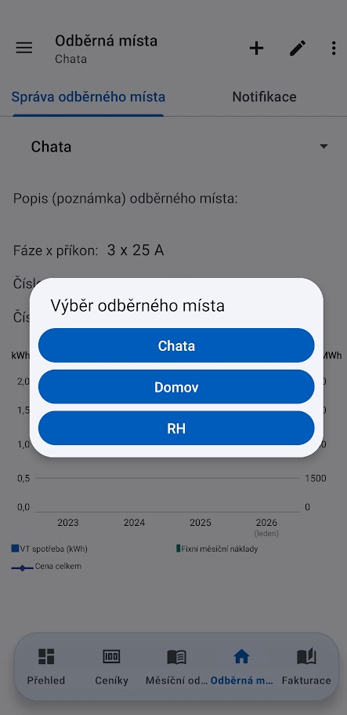

### Správa odběrného místa

Tlačítkem **+** přidáte odběrné místo. Pro změnu údajů vyberte místo z rozbalovacího seznamu a
použijte ikonu tužky **Upravit odběrné místo**. Ve formuláři zadáváte název, volitelný popis, počet
fází a jmenovitý proud hlavního jističe, číslo elektroměru a číslo odběrného místa. Například u
jističe **3 × 25 A** zadejte tři fáze a 25 A. Aplikace tyto hodnoty používá při výpočtu platby za
jistič. Změny potvrďte tlačítkem **Uložit**. Tlačítko **Zpět** zavře formulář bez uložení.

Akce **Smazat odběrné místo** odstraní také údaje vedené pro dané místo, například jeho měsíční
odečty a faktury.

  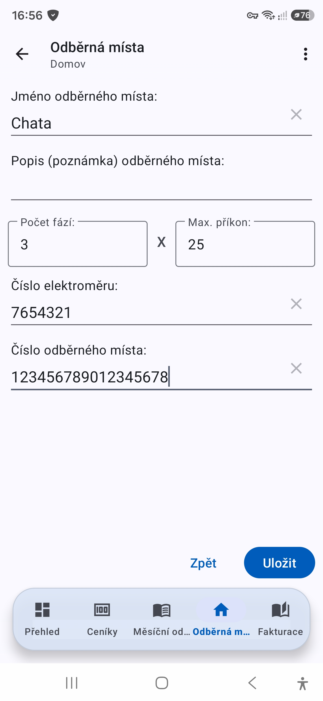
  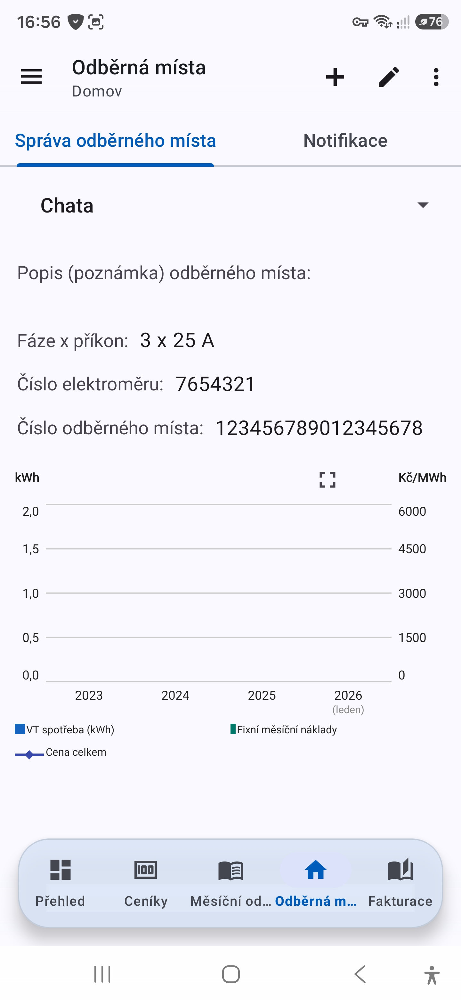

### Připomenutí zápisu odečtu

Vyberte místo a v části **Notifikace** zaškrtněte **Povolit notifikaci pro zápis odečtu**. Vyberte
týdenní nebo měsíční opakování, nastavte čas a podle typu opakování den v týdnu nebo den v měsíci.
Pokud nastavíte den, který v daném měsíci není, aplikace použije poslední den měsíce. Každé odběrné
místo má vlastní nastavení. Na výšku se mezi správou a upozorněními přepíná záložkami, na šířku se
vedle údajů o místě zobrazuje pravý panel se záložkami. Pokud oznámení nepřichází,
zkontrolujte [oprávnění k oznámením a přesným alarmům](#nav-nastaveni).

  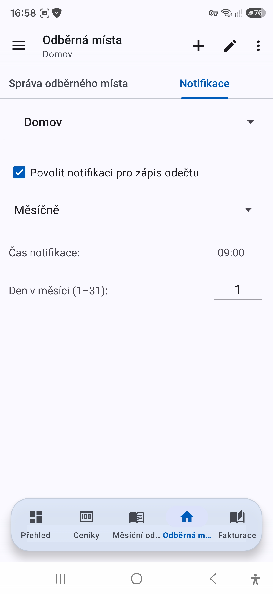

### Graf roční spotřeby a průměrných cen

Ve **Správě odběrného místa** je graf aktuálního roku a tří předchozích let. Rok bez dat má na ose
vyhrazené místo bez sloupce. Graf používá uložené odečty a dostupné stavy z fakturace. Rozdělení
spotřeby mezi části roku může být odhadnuté z okolních záznamů. Pro aktuální rok sledujte rozsah
měsíců pod rokem.

- **Spotřeba VT a NT** je zobrazená skládanými sloupci v kWh nebo MWh. Hodnota nad sloupcem je
  součet obou tarifů.
- **Fixní měsíční náklady** ukazuje tenký sloupec. Jde o průměr v Kč/měsíc včetně DPH (daně z
  přidané hodnoty). Zahrnuje stálý plat dodavateli, platbu za jistič, poplatek za činnost operátora
  trhu (OTE), případně odpovídající infrastrukturní poplatek, a tam, kde se ve výpočtu uplatní, i
  příspěvek na podporované zdroje energie (POZE).
- **Cena VT** a **Cena NT** jsou průměrné ceny za 1 MWh včetně DPH, vážené spotřebou v jednotlivých
  úsecích. Zahrnují dodávku, distribuci za odebranou energii, systémové služby a daň z elektřiny.
  Stálé měsíční platby se zobrazují samostatně.
- **Cena celkem** je vypočtená průměrná cena. Aplikace vydělí součet nákladů za spotřebu v obou
  tarifech a stálých nákladů celkovou spotřebou v MWh. Stejné stálé platby mají při nižší spotřebě
  větší vliv na cenu za 1 MWh. Pokud v odečtech chybí přiřazený ceník, může graf pro výpočet použít
  první dostupný ceník ze společného seznamu. Pro ověření skutečné vyúčtované ceny použijte fakturu
  dodavatele.

Klepnutím na sloupec nebo bod otevřete detail vybraného roku. Ikona rozšíření v pravém horním rohu
grafu otevře celou dostupnou historii. Posouváním do stran zobrazíte starší roky. Při posouvání
zůstávají svislé osy a legenda na místě. Graf se otevírá u aktuálního období a při zobrazení na
výšku nabídne otočení zařízení na šířku.

  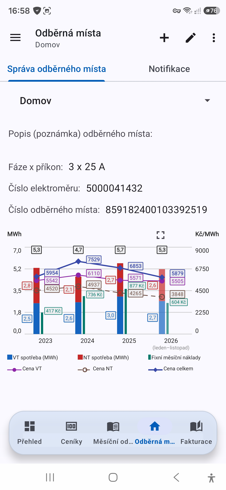

  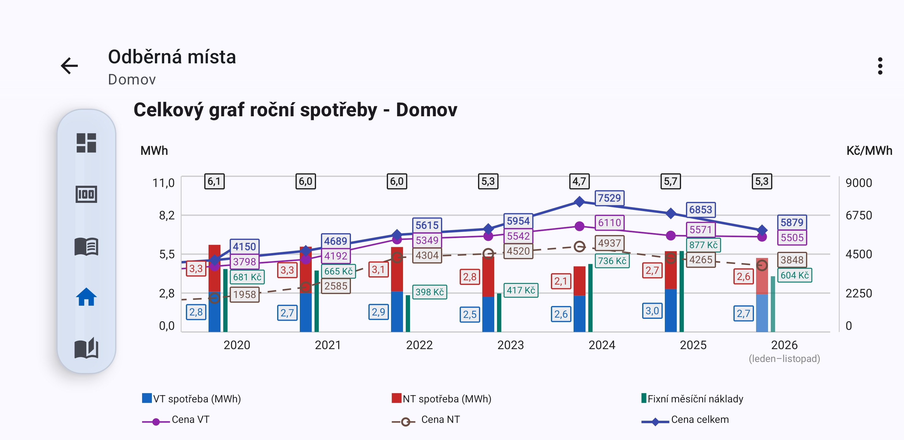

## Ceník

V hlavní nabídce otevřete **Ceníky**. Při výběru pro odečet nebo fakturu ověřte dodavatele, produkt,
distribuční území, sazbu a období platnosti.

V seznamu ceníků se zobrazuje název produktové řady, období platnosti, název produktu, distribuční
sazba, distribuční území a dodavatel. Ve spodní části položky je jednotková cena v Kč/kWh pro VT a
případně NT a součet stálých plateb za měsíc. Údaj o původu a stavu regulovaných cen
vysvětluje [kapitola Filtrace ceníků](#filtrace-ceniku).

### Nový ceník

Otevřete **Přidat ceník** tlačítkem **+** nebo v horní liště podle nastavení. Ve formuláři zadejte
tyto údaje.

- název produktové řady,
- název produktu nebo sazby,
- dodavatel,
- distribuční sazba,
- distribuční území,
- období platnosti ceníku,
- obchodní cena za dodávku ve VT a případně v NT v Kč/MWh bez DPH,
- stálý měsíční plat dodavateli v Kč/měsíc bez DPH.

V seznamu aplikace zobrazí jednotkové ceny s DPH, tedy dodávku a příslušné spotřební položky,
například distribuci a daň z elektřiny. U měsíční částky se k platu dodavatele přičítá regulovaná
platba za jistič a příslušná pevná regulovaná platba. Pokud je u ceníku dostupná historická úprava
pro rok 2023, může seznam zobrazit i cenu se zastropováním.

  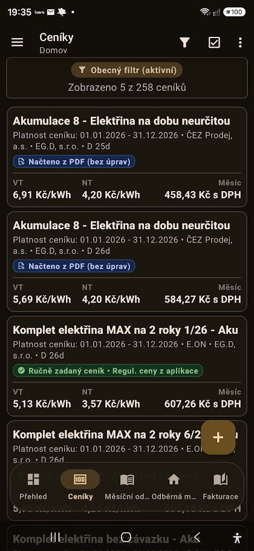

U jednotarifních sazeb, například D01d nebo D02d, se nízký tarif nepoužívá. Položku nízkého tarifu tedy není nutné vyplňovat podle samostatné ceny NT.

Aplikace obsahuje přednastavené regulované ceny od roku 2021 pro všechna tři distribuční území.
Zkontrolujte distribuční území, sazbu i období platnosti a v případě potřeby použijte **Načíst
regulované platby**. Obchodní ceny opište z části ceníku dodavatele věnované dodávce elektřiny.

Níže ve formuláři jsou zobrazeny regulované položky ceníku. V případě potřeby je lze upravit ručně,
běžně to ale není doporučeno. Pokud se regulované položky liší od podkladů aplikace, seznam může
ceník označit štítkem **Upravené regulované ceny**. Pokud v přednastavených regulovaných cenách
najdete chybu, můžete ji nahlásit na e-mail **x.listo@seznam.cz**.

Datum platnosti je důležité pro správné přiřazení ceníku k měsíčnímu odečtu nebo faktuře. Platnost ceníku se kontroluje proti datu záznamu. Pokud aplikace najde nesoulad, zobrazí v záhlaví měsíčního záznamu nebo faktury upozornění.

Tlačítkem **Uložit** se ceník uloží. Tlačítkem **Zpět** se provedené změny zahodí a zobrazí se seznam ceníků.

  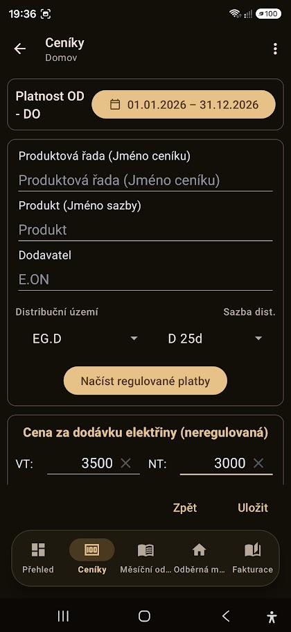
  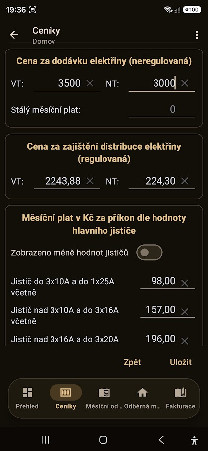

  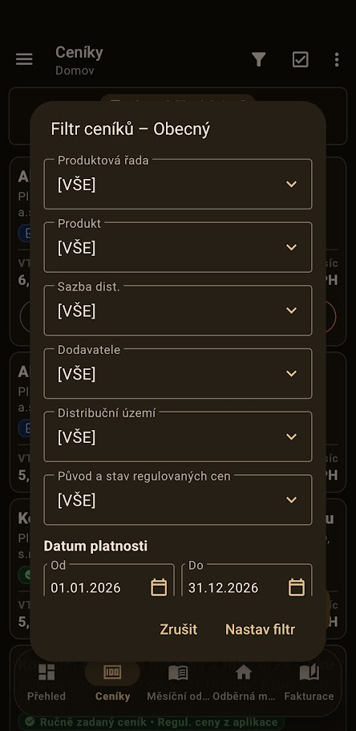

### Úprava ceníků

Klepnutím na položku ceníku v seznamu se zobrazí dostupné akce **Uprav**, **Detail** a **Smaž**.

Tlačítkem **Uprav** se otevře formulář podobný formuláři pro přidání nového ceníku. Rozdíl je v tom, že jednotlivá pole jsou již předvyplněna údaji vybraného ceníku. Tyto hodnoty lze podle potřeby změnit a uložit.

Ve formuláři je také tlačítko **Načíst regulované platby**. Slouží pro opětovné načtení regulovaných položek podle zvoleného distribučního území, distribuční sazby a období platnosti. To se hodí například v případě, kdy se regulované položky po změně výběru distribučního území nebo sazby z nějakého důvodu nenačtou automaticky.

Tlačítkem **Uložit** se změny uloží. Tlačítkem **Zpět** se provedené změny zahodí a zobrazí se seznam ceníků.

Na výšku otevřete jednotlivé ceny tlačítkem **Detail**. Na šířku se detail vybrané položky zobrazuje
vedle seznamu. Volba **Smaž** odstraní ceník po potvrzení. V **Režimu výběru** lze označit více
ceníků a v nabídce zvolit jejich smazání nebo [porovnání](#nav-porovnani-ceniku). Volba **Smazat
nevyužité ceníky** vyhledá ceníky bez vazeb na evidované záznamy a umožní jejich hromadné
odstranění.

### Automatický import ceníku z PDF

PDF ceník můžete do aplikace předat z jiné aplikace nebo ho vybrat z úložiště. Pro výměnu ceníků ve
formátu JSON použijte [Import ceníků](#nav-import-ceniku).

#### Otevření nebo sdílení souboru

V prohlížeči nebo čtečce PDF zvolte u otevřeného souboru **Otevřít v jiné aplikaci** (někdy **Další
aplikace**) a vyberte **El. odečty**. Stejný import můžete spustit přes **Sdílet → El. odečty**,
například ze správce souborů. Aplikace ceník načte a zobrazí sazby k potvrzení. Pokud prohlížeč
předává jen webový odkaz, stáhněte PDF a vyberte ho podle následujícího postupu.

Ve správci souborů můžete označit několik PDF a sdílet je do **El. odečtů** najednou. Aplikace je
zpracuje postupně. U každého ceníku vyberte sazby a klepněte na **Uložit vybrané**. Pokud tento
soubor chcete vynechat, klepněte na **Přeskočit soubor**. Dokud čekají další soubory, můžete
klepnout na **Ukončit import**. Tím opustíte aktuální soubor a zrušíte zpracování zbývajících PDF.
Už uložené ceníky zůstanou v aplikaci.

Při importu více souborů se ukazatel **Hotovo X z Y souborů** zobrazuje při načítání, výběru sazeb i
při chybě importu. Do počtu hotových se započítávají uložené i přeskočené soubory. Při výběru sazeb
můžete použít také **Vybrat vše** nebo **Zrušit výběr**.

Snímky ukazují výběr sazeb u tří souborů v jedné dávce. První a třetí ceník nelze uložit, protože
aplikaci pro jejich období chybějí regulované ceny. Druhý ceník lze uložit a upozornění uvádí, že
jeho platnost byla nastavena do 31. 12. 2026. Před uložením zkontrolujte období i vybrané sazby.
Tlačítko **Přeskočit soubor** je dostupné u všech tří souborů. **Ukončit import** je vidět u prvních
dvou, protože po nich ještě čeká další PDF.

  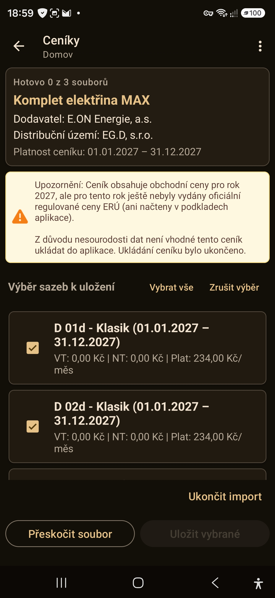
  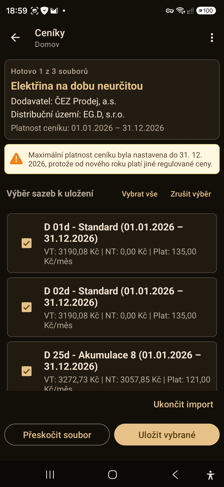
  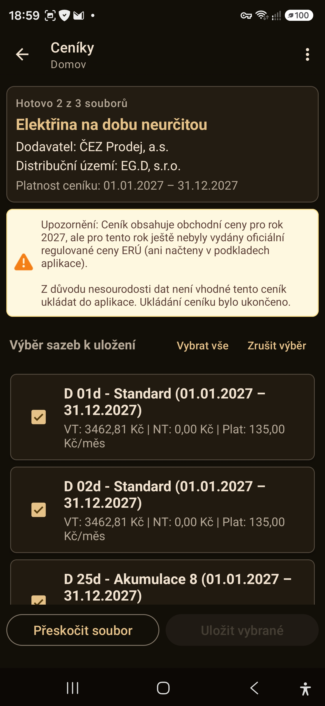

#### Stažení ceníku a výběr z úložiště

1. Na obrazovce **Ceníky** otevřete nabídku se třemi tečkami a zvolte **Stáhnout ceníky**. U svého
   dodavatele klepněte na **Otevřít stránku**. V prohlížeči podle potřeby vyberte distribuční území
   nebo období a stáhněte PDF do zařízení, například do složky **Stažené soubory**.
2. Vraťte se na obrazovku **Ceníky** a zvolte **Přidat ceník z PDF**. Podle nastavení je tato akce v
   nabídce tlačítka **+** nebo v horní liště. V systémovém výběru souborů otevřete umístění, kam
   jste PDF uložili, a vyberte stažený soubor.

  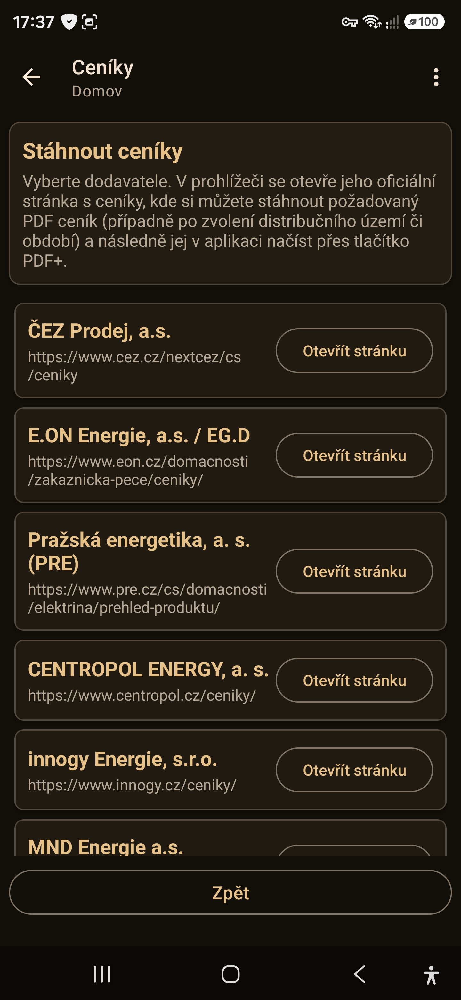

Pro úspěšný automatický import je nutné použít **kompletní PDF ceník** obsahující jak obchodní ceny
dodavatele (silovou elektřinu a stálý měsíční plat), tak i distribuční ceny, platby za hlavní
jistič, ostatní regulované poplatky a daň z elektřiny. Zkrácené ceníky, které uvádějí pouze obchodní
ceny, nelze automaticky načíst.

#### Podporované formáty a řešení chyb

Na obrazovce **Ceníky** otevřete **Podporované ceníky** v nabídce nebo pod tlačítkem **+**. Najdete
zde ukázky podporovaných PDF od společností Centropol, ČEZ, E.ON, innogy, MND, PRE a TEDOM.
Klepnutím na ukázku ji zvětšíte na celou obrazovku a můžete porovnat její strukturu se svým
souborem. Tlačítko **Vybrat PDF ceník** otevře výběr souborů.

Pokud selže import jednoho PDF, dialog nabídne **Zobrazit podporované ceníky** nebo **Vybrat jiný
soubor**. Při hromadném importu zvolte **Přeskočit soubor**. Pokud další soubory ještě čekají,
můžete použít také **Ukončit import**.

#### Kontrola před uložením

Před uložením ověřte načtené ceny a platnost podle PDF. Pokud některá vybraná sazba už v aplikaci
existuje, dialog **Ceník již existuje** zobrazí porovnání původních a nových hodnot. Potvrzením
aktualizujete odpovídající ceníky a uložíte nové sazby z aktuálního výběru. Odmítnutím se vrátíte k
výběru sazeb bez uložení.

U některých ceníků platných před zářím 2025 se zobrazí i volba **Vytvořit i ceníky pro 2. období
roku 2025**. Ponechte ji zaškrtnutou, pokud chcete do výběru sazeb zahrnout také varianty pro období
od 1. září do 31. prosince 2025 s odlišnou cenou za provoz nesíťové infrastruktury.

## Měsíční záznamy

V hlavní nabídce otevřete **Měsíční odečty**. Seznam patří k aktivnímu odběrnému místu. Aplikace
vypočítá spotřebu v kWh z rozdílu stavů počítadel VT a NT. Z přiřazeného ceníku dopočítá náklady na
spotřebu a stálé platby za délku období. Vypočtené náklady s DPH porovná se zadanou zálohou. Zelený
rozdíl označuje, že záloha převyšuje náklady, červený, že náklady převyšují zálohu.

### Zobrazení a období odečtů

Ikonou posuvníků v horní liště otevřete **Možnosti zobrazení**. V části **Zobrazení odečtů** vyberte
jednu ze tří možností.

- **Podrobné zobrazení** ukáže ceník, období, délku období, stavy počítadel, spotřebu, dílčí
  náklady, zálohu a bilanci.
- **Stručné zobrazení** ponechá stavy počítadel, spotřebu a náklady, ale skryje část podrobností.
- **Krátké zobrazení** ukáže hlavně celkovou spotřebu, celkovou cenu a rozdíl proti záloze.

Volba **Zohlednit zastropování cen v roce 2023** zapne přepočet podle historické úpravy cen tam, kde
se použije. Nastavení potvrďte tlačítkem **Použít**.

  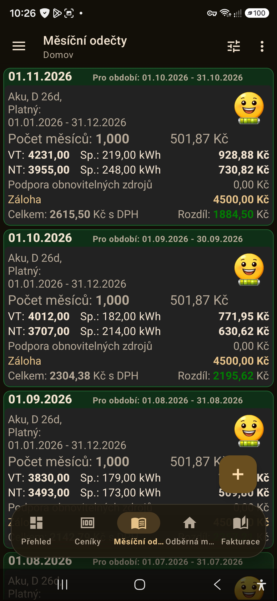
  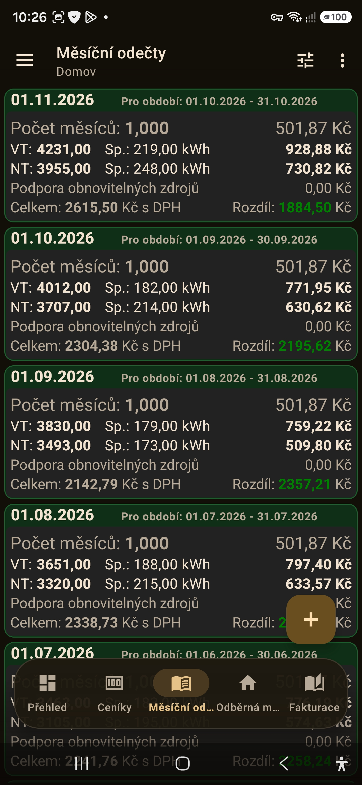
  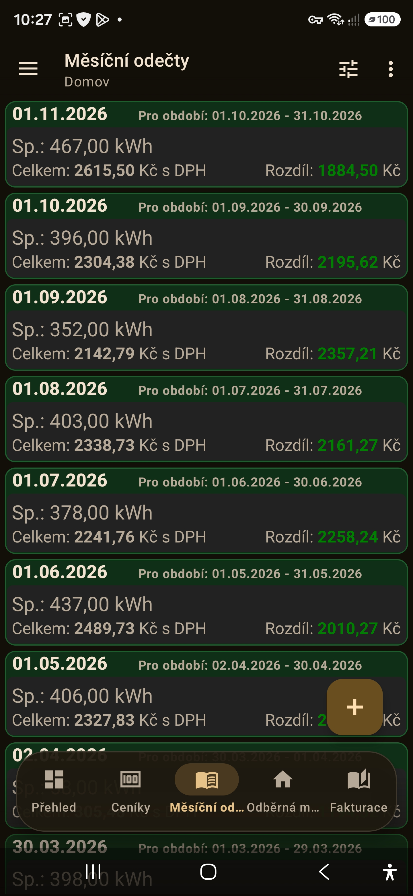

V kartě **Období** nastavte mezní data **Od** a **Do**, vyberte rozsah v kalendáři nebo použijte
předvolbu **Od nového roku**, **Posledních 6 měs.**, **Poslední rok** nebo **Všechny odečty**.
Rozsah potvrďte tlačítkem **Použít filtr** a obrazovku **Možnosti zobrazení** tlačítkem **Použít**.
Nad omezeným seznamem uvidíte zobrazené období, počet záznamů a souhrnnou bilanci filtrovaných
odečtů. Předvolba **Všechny odečty** zruší časové omezení.

  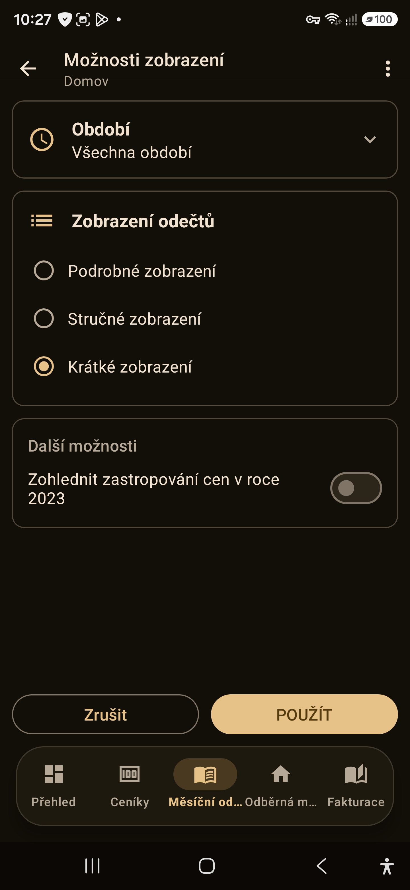
  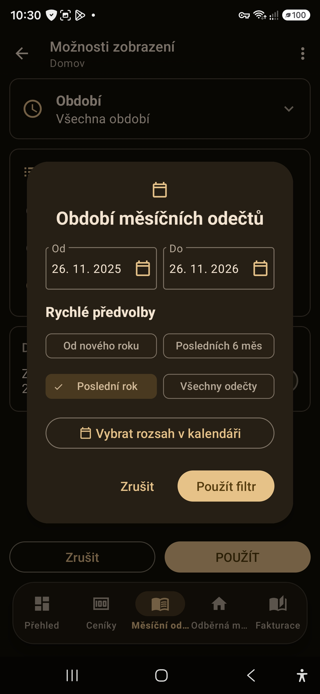
  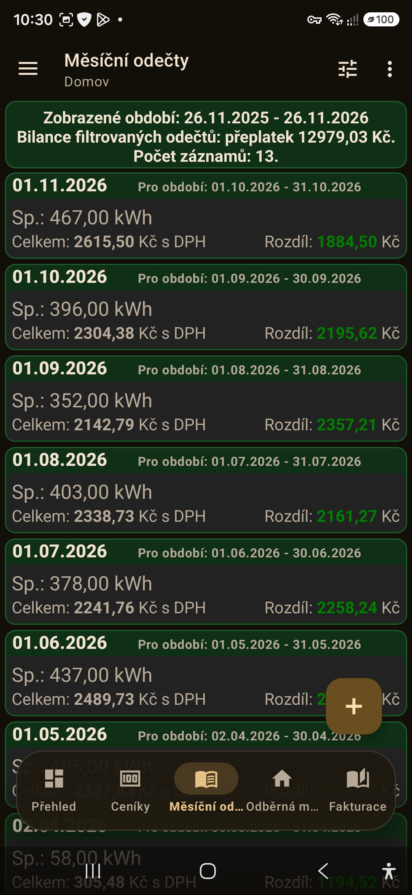

Příspěvek POZE je samostatná položka výpočtu. Ve výpočtu odečtů záleží na roku období a hodnotě z
použitého ceníku. [Fakturace](#nav-fakturace) zohledňuje pravidla pro POZE za fakturované období, a
proto výsledek nemusí odpovídat prostému sečtení měsíčních částek.

### Přidání měsíčního záznamu

1. Klepněte na **+** a ve formuláři zkontrolujte **Datum odečtu**. Klepnutím na datum otevřete
   kalendář. Pokud aplikace datum předvyplní, můžete je změnit.
2. Zadejte stav počítadla vysokého tarifu a při dvoutarifním odběru také stav počítadla nízkého
   tarifu. Údaje jsou stavy elektroměru v kWh.
3. U běžného odečtu doplňte **Pravidelnou měsíční platbu (zálohu)** a
   zkontrolujte [přiřazený ceník](#nav-vyber-ceniku-odecty). První odečet slouží jako výchozí stav
   pro výpočet spotřeby. První odečet i záznam typu **Výměna elektroměru** lze uložit bez ceníku a
   nezadává se u nich záloha.
4. Pokud potřebujete poznámku nebo jednorázovou částku za další služby či slevy, zaškrtněte **Další
   údaje**. Záznam potvrďte tlačítkem **Uložit** nebo opusťte tlačítkem **Zpět**.

Pokud se zobrazí upozornění na chybějící poslední fakturu, můžete pokračovat v evidenci odečtů. Pro
průběžnou bilanci od určitého data doplňte [výchozí hodnoty ve fakturaci](#nav-fakturace).

  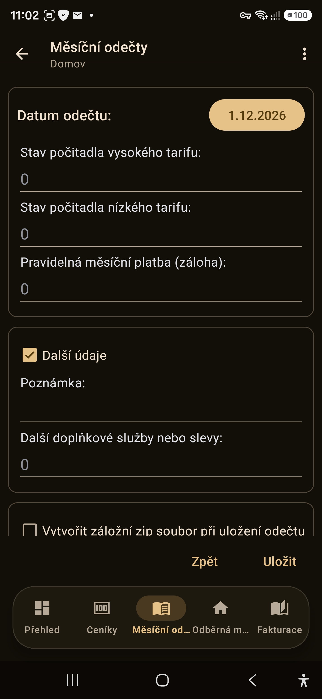
  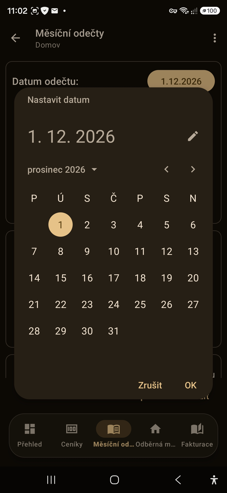

### Další měsíční záznamy

Při dalších odečtech zapisujte aktuální stavy a pro každý interval kontrolujte platnost přiřazeného
ceníku. Ve spodní části nového odečtu najdete tyto volby.

- **Přidat zálohu do seznamu plateb Fakturace** zapíše zadanou zálohu také do plateb v **Období bez
  faktury**. Při ukládání zkontrolujte datum platby.
- **Vytvořit záložní zip soubor při uložení odečtu** vytvoří [lokální zálohu](#nav-zaloha-lokalni).
- **Výměna elektroměru** označí výchozí stav nového elektroměru. Konečný stav původního elektroměru
  zaznamenejte běžným odečtem, aby se spotřeba do jeho výměny započítala.

Klepnutím na uložený odečet zobrazíte akce **Uprav**, **Detail** a **Smaž**. Pokud záznam nemá
vypočtenou spotřebu, akce **Detail** může být skrytá. V detailu běžného odečtu lze zkontrolovat
dílčí položky výpočtu. Změna nebo odstranění stavu může ovlivnit i výpočet následujícího odečtu.

### Výběr ceníku pro měsíční záznam

Ve formuláři klepněte na tlačítko ceníku. Při novém odečtu aplikace přednostně nabízí ceník z
posledního odečtu daného místa, případně naposledy zvolený ceník. Po změně dodavatele, produktu nebo
ceny ověřte, že se vypočítá správné období.

V seznamu klepněte na požadovaný ceník. Nabídku
zúžíte [filtrem pro měsíční odečty](#filtrace-ceniku). Šipkou zpět se vraťte do formuláře,
zkontrolujte název a platnost vybraného ceníku a uložte odečet.

  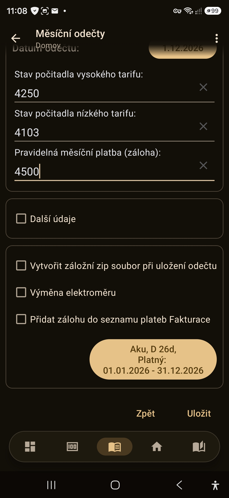
  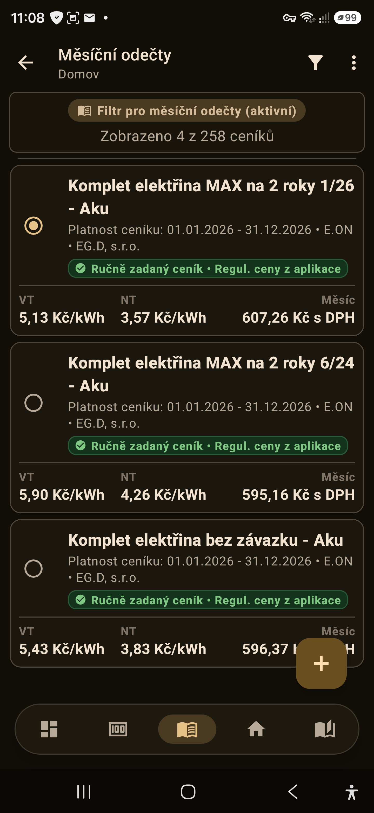
  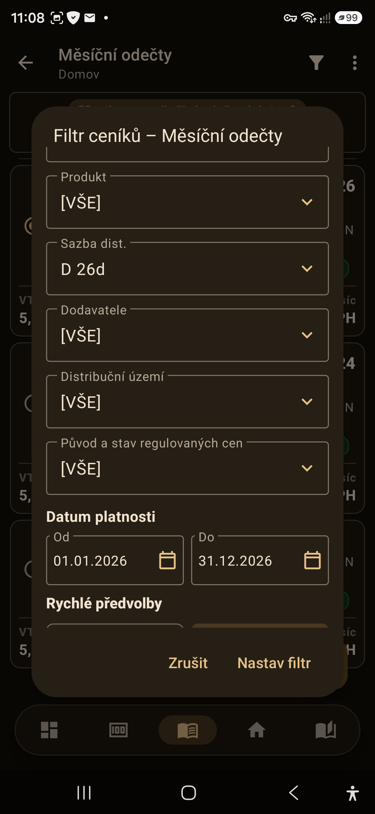

## Záznam faktur

V aplikaci lze ukládat již obdržené faktury a vést jejich historii. Díky tomu je možné zpětně zobrazit spotřebu, zaplacené zálohy a výsledek vyúčtování za jednotlivá období.

V hlavní nabídce otevřete **Fakturace**. Uložené faktury jsou seřazené podle počátku období od
nejnovější. Pokud má aplikace datum začátku i konce, nahoře zobrazí také **Období bez faktury**.
Průběžná bilance za toto období vychází ze spotřeby od posledního vyúčtování nebo od ručně zadaného
začátku po poslední měsíční odečet.

Pokud v aplikaci není zadána žádná starší faktura, lze pro výpočet období bez faktury nastavit výchozí hodnoty ručně. Zadává se datum a počáteční stav měřičů VT a NT. U jednotarifních elektroměrů se pole NT ponechá na hodnotě 0.

V horní liště **Fakturace** otevřete **Nastavení**. Přepínač **Automatický režim generování období
bez faktury** volí mezi automatickým a poloautomatickým režimem. Pokud jsou v poloautomatickém
režimu provedeny ruční změny, přepnutím zpět do automatického režimu se tyto změny přepíší podle
měsíčních odečtů.

  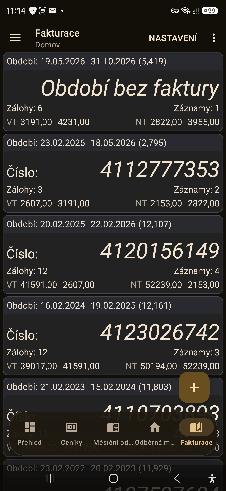
  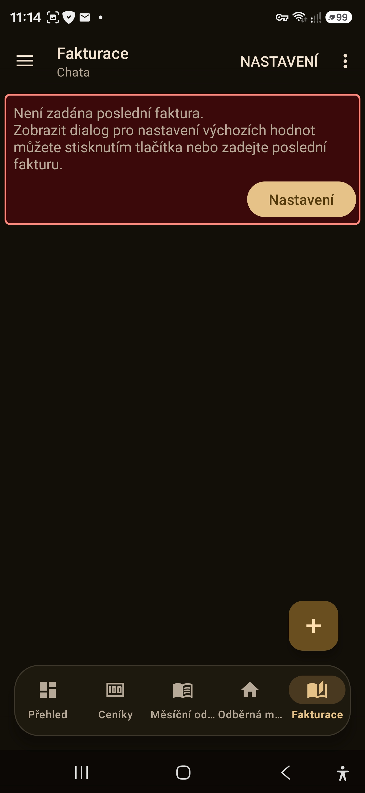
  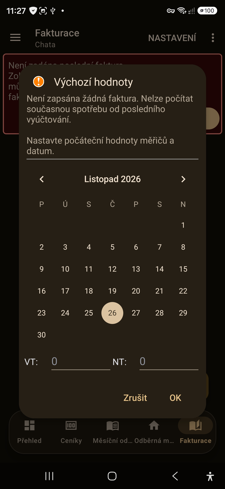
  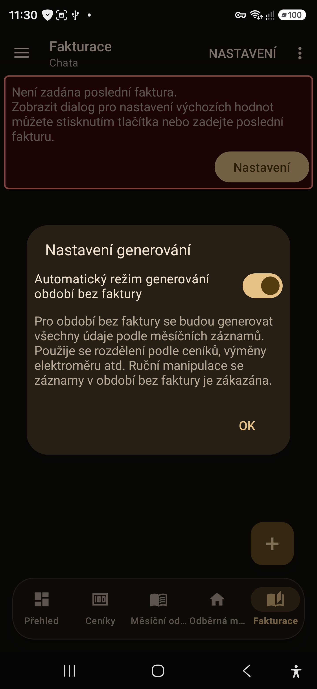

### Automatický režim

Automatický režim plně přebírá změny zapsané v měsíčních odečtech. Pokud je například v měsíčních odečtech změněn ceník nebo je zaznamenána výměna elektroměru, aplikace podle těchto údajů automaticky rozdělí celé období na odpovídající části.

Každá část období má vlastní datum, počáteční a koncový stav měřiče a příslušný ceník. Aplikace následně dopočítá spotřebu a cenu za celé období.

Pro většinu uživatelů je automatický režim nejjednodušší a nejvhodnější varianta, protože nevyžaduje ruční zásahy. Pokud některé údaje nesouhlasí, je vhodné je opravit přímo v měsíčních odečtech.

### Poloautomatický režim

Poloautomatický režim načítá pouze stav měřičů z poslední uložené faktury, případně z ručně zadaných výchozích hodnot, a poslední stav měřičů zadaný v měsíčních odečtech. Výsledkem je jeden souhrnný záznam, který automaticky nezohledňuje například výměnu elektroměru nebo změnu ceníku.

Rozdělení období na jednotlivé části je v tomto režimu plně na uživateli. Klepnutím na položku záznamu se zobrazí dostupná tlačítka pro úpravu.

- **Uprav** otevře formulář, ve kterém můžete podle dostupnosti polí změnit datum, stavy počítadel
  VT a NT, použitý ceník a další služby nebo označit záznam jako **Výměna elektroměru**. Tím se u
  dané položky vypne kontrola návaznosti stavů měřidel. Zašedlé údaje nelze měnit, protože jde o
  hraniční hodnoty převzaté z posledního měsíčního odečtu nebo poslední uložené faktury. Pokud je
  nutné tyto hodnoty změnit, je potřeba je upravit na příslušném místě aplikace.
- **Rozděl** – rozdělí jeden záznam na dvě části. V dialogu lze nastavit dělicí datum a stav měřičů VT a NT. Výchozí hodnota je nastavena přibližně na polovinu období. Hodnoty lze změnit posuvníky nebo zadáním do textových polí. V horní části dialogu je zobrazen náhled rozdělení. Tlačítkem **Rozděl** se záznam rozdělí na dvě navazující části.
- **Spoj s předchozím** sloučí záznam se záznamem, který je v seznamu pod ním. V dialogu se zobrazí
  náhled obou úseků a výsledku sloučení. Po kontrole klepněte na **Spoj**.

  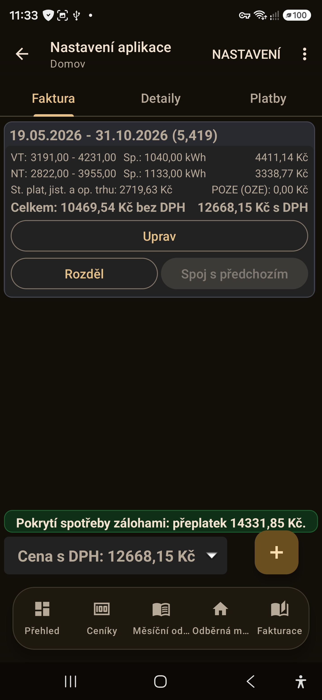
  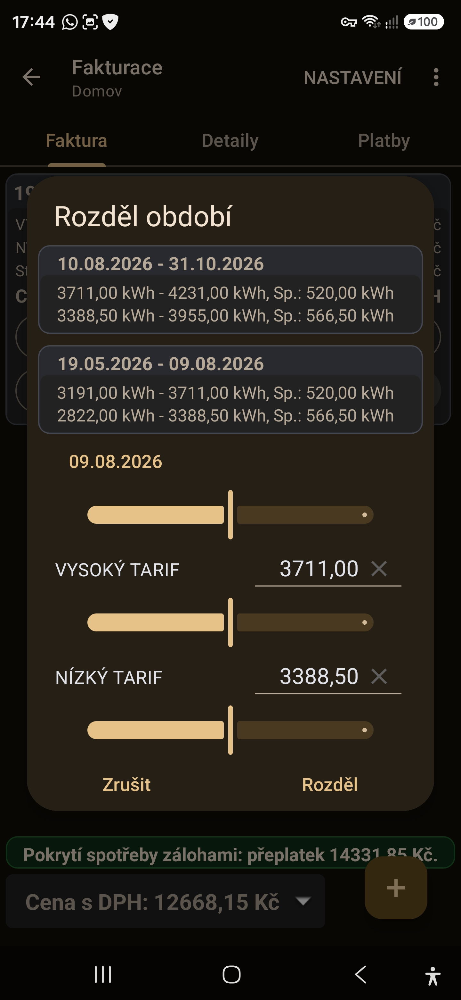
  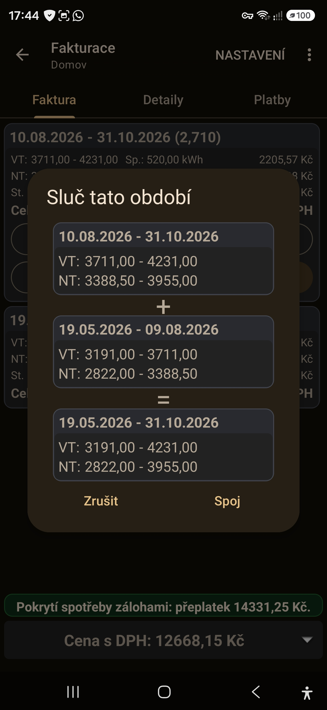
  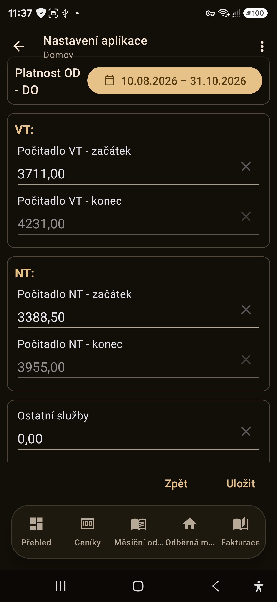

Pokud na sebe dva sousední záznamy nenavazují, aplikace zobrazí výstražnou ikonu a zvýrazní dotčené
údaje červeně. Na prvním snímku se liší koncový a počáteční stav počítadla VT. Na druhém je navíc
mezera v datech. Starší záznam končí 9. 8. a novější začíná 11. 8., takže 10. 8. chybí. Přes
**Uprav** zkontrolujte hraniční data a stavy počítadel podle skutečných odečtů.

  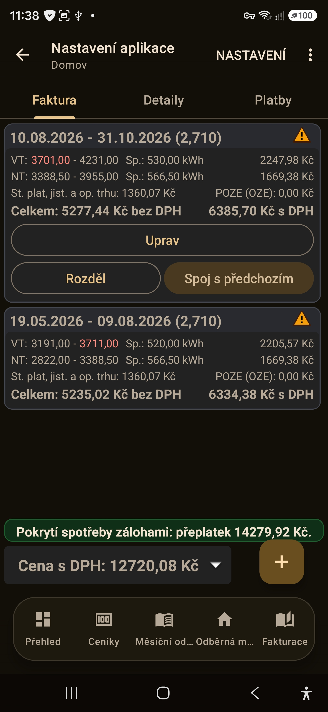
  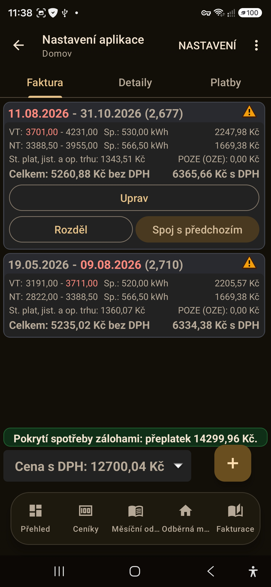

### Detail faktury

Faktura se zobrazuje ve třech záložkách: **Faktura**, **Detaily** a **Platby**.

První záložka **Faktura** obsahuje vlastní odečtové záznamy. Každý záznam má přiřazený ceník, podle kterého se počítá cena spotřebované elektrické energie. Pokud je záznamů více, celkový součet faktury se zobrazuje v dolní liště.

Klepnutím na spodní součet se zobrazí panel se všemi dostupnými součty. Lze vybrat položku, která se bude zobrazovat ve spodní části obrazovky:

- celková spotřeba VT,
- celková spotřeba NT,
- celková spotřeba VT a NT,
- cena VT bez DPH,
- cena NT bez DPH,
- cena stálých plateb bez DPH,
- příspěvek na podporované zdroje energie (POZE),
- celková cena bez DPH,
- celková cena s DPH,
- zaplacené zálohy,
- bilance.

Ve spodní části obrazovky se zobrazuje také rychlá informace o poměru zaplacených záloh k vypočtené ceně za dané období. Zeleně je označen přeplatek, červeně nedoplatek.

Druhá záložka **Detaily** zobrazuje dílčí výpočty faktury. Tuto část lze využít pro kontrolu proti faktuře od dodavatele a pro dohledání případných rozdílů ve výpočtech.

Třetí záložka **Platby** eviduje platby a slevy pro otevřenou fakturu nebo **Období bez faktury**.
Záloha zapsaná u měsíčního odečtu se sem přenese, pokud při vytvoření odečtu zaškrtnete **Přidat
zálohu do seznamu plateb Fakturace**.

  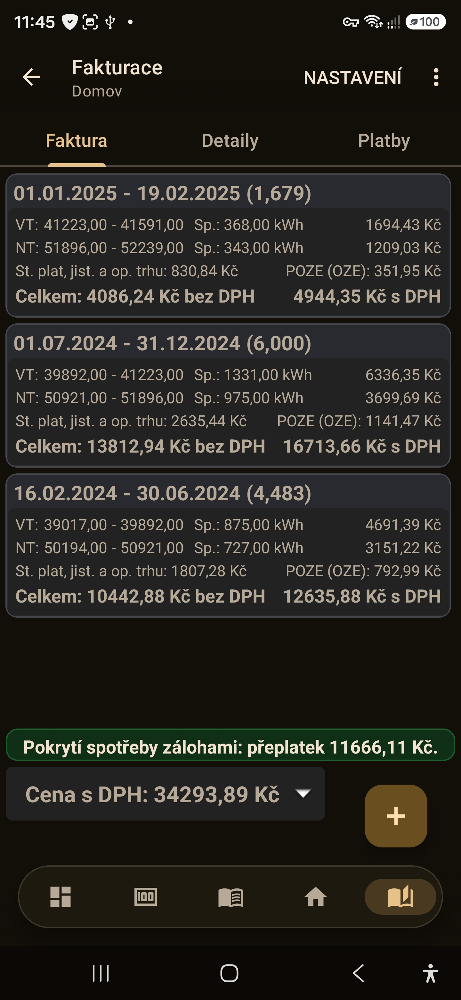
  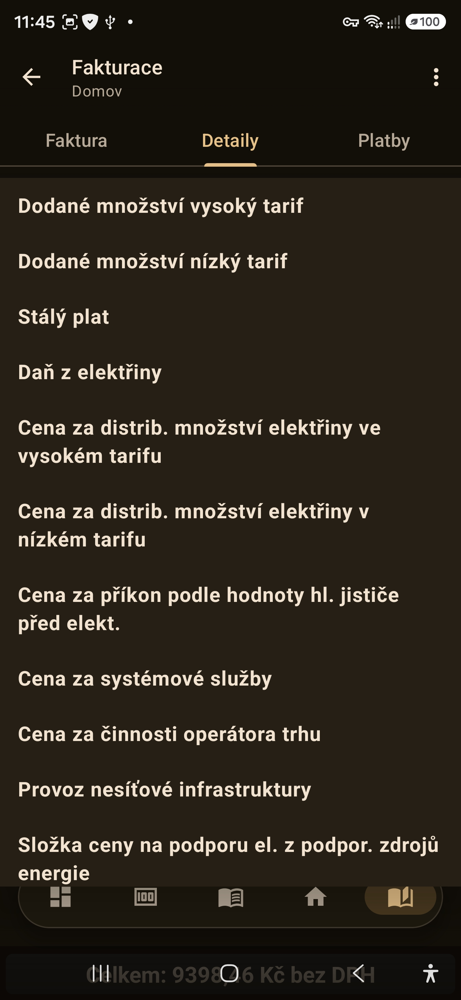
  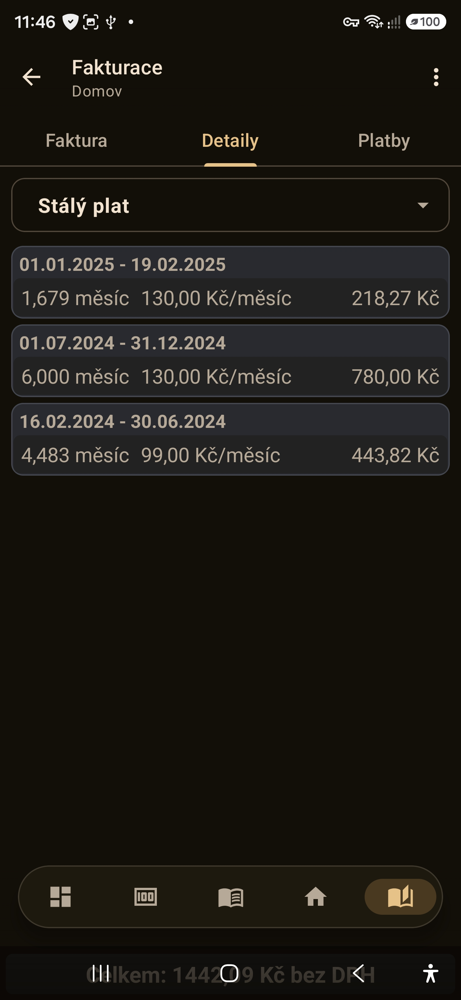
  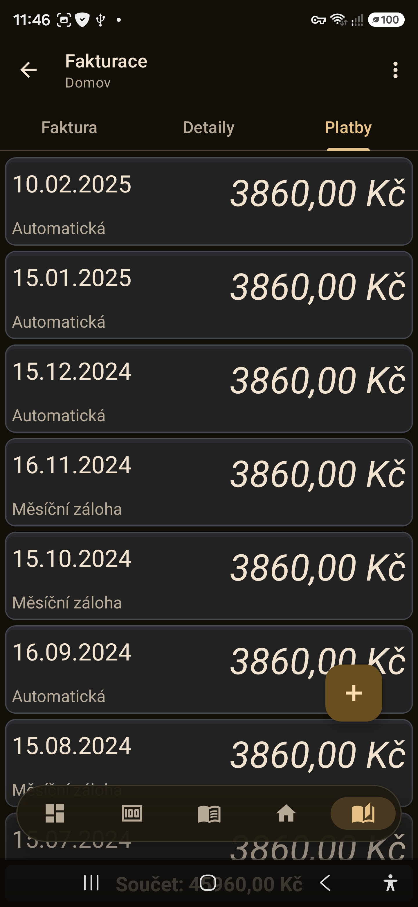

### Přidání a úprava uložených faktur

V seznamu faktur lze přidávat již existující vyúčtovací faktury. Dialog pro přidání nové faktury se otevře tlačítkem **+**.

Nejprve se zadá číslo faktury nebo jiné označení pro lepší orientaci. Po potvrzení se v seznamu
vytvoří nová faktura. Nová faktura zatím nemá vyplněná data ani stavy měřičů, proto se u ní může
zobrazit upozornění na nenavazující nebo neúplné záznamy.

Klepnutím na položku faktury se zobrazí její ovládací tlačítka. Lze změnit číslo faktury, přidat odečtové záznamy, přidat zálohové platby nebo celou fakturu smazat.

  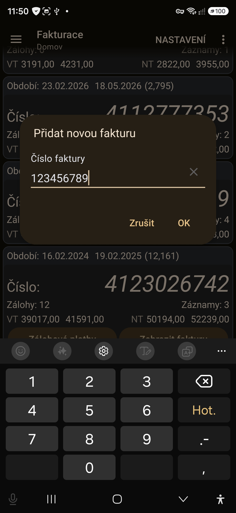
  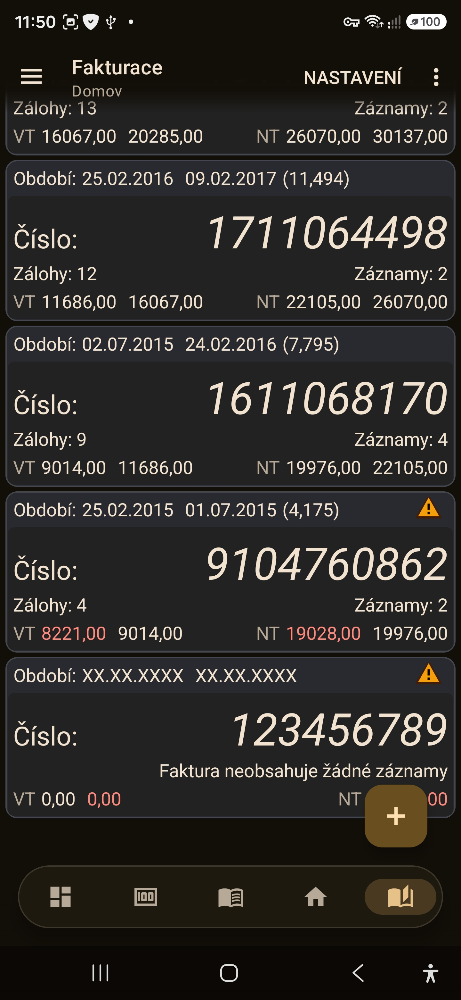

### Přidání a úprava zálohové platby

Tlačítko **Zálohové platby** v seznamu faktur otevře platby vybrané faktury. Nová platba se přidává
tlačítkem **+**.

U platby zadejte datum, částku a druh položky. **Záloha** a **Doplatek** zvyšují součet zaplacených
plateb, **Přeplatek** ho snižuje. **Sleva bez DPH** snižuje základ před přičtením DPH, **Sleva s
DPH** snižuje cenu s DPH. Formulář nabízí také **Jednorázovou podporu státu (2000 nebo 3500)** pro
evidenci dříve přiznaného příspěvku.

Již zadané platby lze upravovat. Klepnutím na položku platby se zobrazí tlačítka pro úpravu, odstranění nebo přiřazení platby k jiné faktuře. Dialog pro úpravu je stejný jako dialog pro přidání, pouze jsou v něm předvyplněné původní hodnoty. Smazání platby se provede po potvrzení dialogu.

  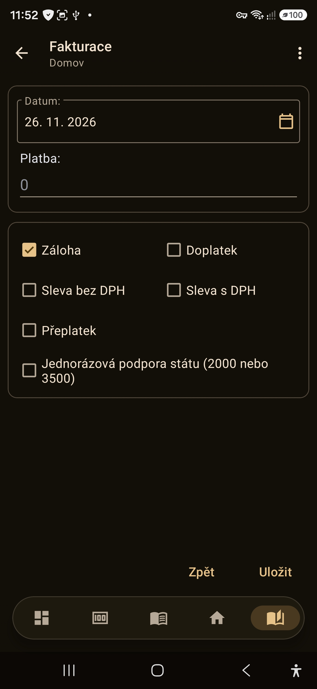
  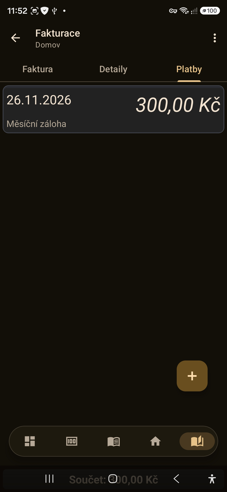
  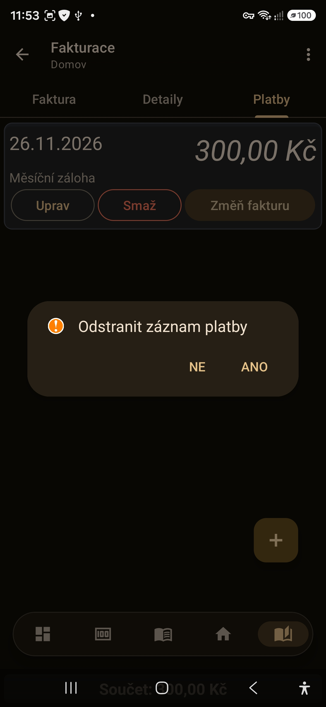

### Přidání a úprava záznamů faktury

Pokud je otevřena obrazovka zálohových plateb, lze se pomocí záložky přepnout zpět na záznamy faktury. Nový odečtový záznam se přidává tlačítkem **+**.

Ve formuláři zkontrolujte předvyplněné údaje a podle faktury vyplňte začátek a konec období,
počáteční a konečné stavy počítadel VT a NT a příslušný ceník. Pokud se v období změnil ceník nebo
elektroměr, zadejte odpovídající úseky samostatně. Dole se zobrazuje vypočtená bilance z nákladů a
evidovaných plateb. Stejný princip platí pro **Období bez faktury**.

Tlačítkem **Uprav** lze záznam změnit, pokud některá položka nesouhlasí. Záznam lze také odstranit po potvrzení dialogu. Funkce pro rozdělení a sloučení záznamů se u ručně uložených faktur nepoužívají, protože zde nejsou potřeba průběžné výpočty k aktuální spotřebě.

V seznamu se faktura zařadí podle začátku zadaného období. Pokud se u ní zobrazí varování,
zkontrolujte úplnost údajů a návaznost období a stavů měřičů.

  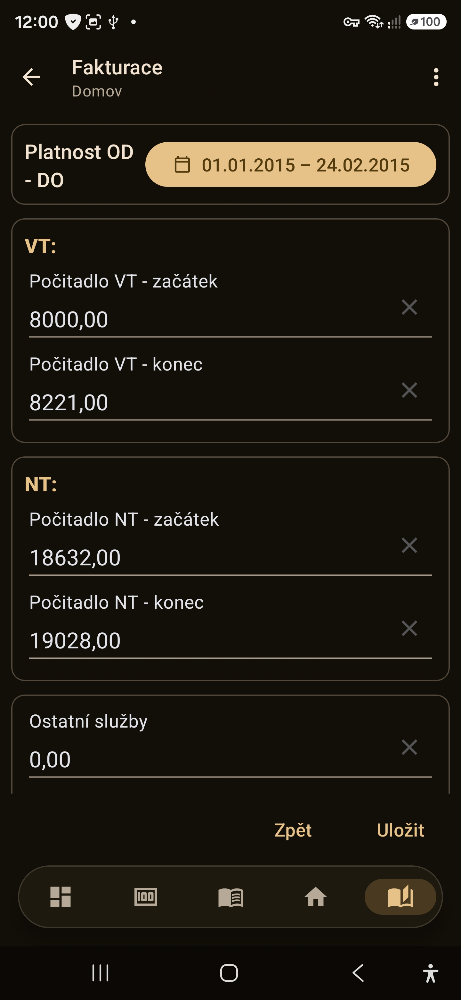
  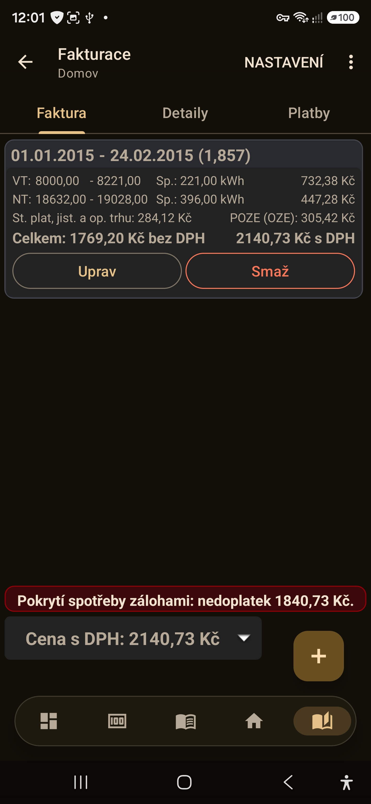
  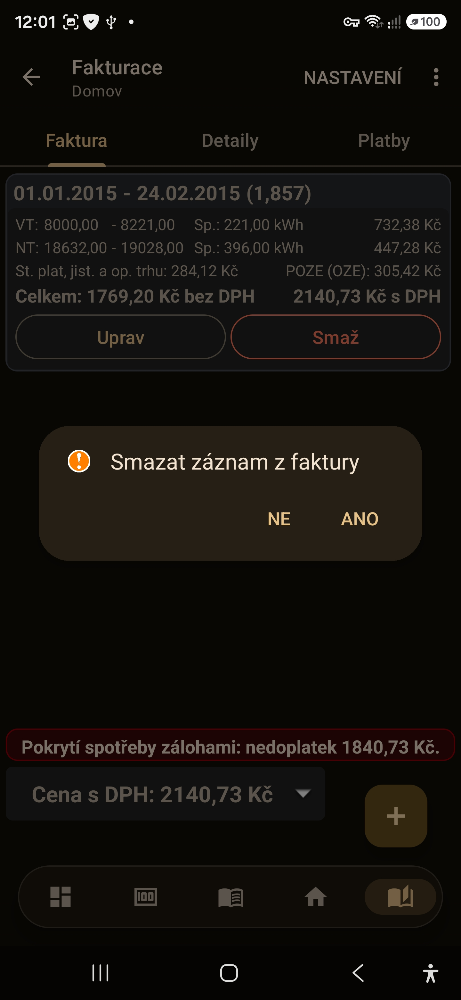
  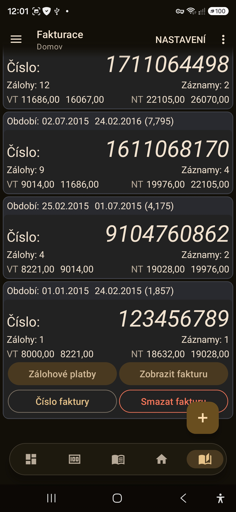

## Filtrace ceníků

Filtrování zkrátí seznam uložených ceníků podle dodavatele, distribuční sazby, území, platnosti a
dalších údajů. Každé odběrné místo má tři vlastní filtry. Díky tomu můžete mít pro pravidelné
odečty připravené aktuální ceníky a současně ve fakturaci hledat ceníky ze starších let.

<table>
  <thead>
    <tr><th>Filtr</th><th>Kde jej otevřít</th><th>Který seznam ovlivní</th></tr>
  </thead>
  <tbody>
    <tr><td><strong>Filtr ceníků – Obecný</strong></td><td>V seznamu <strong>Ceníky</strong> nebo v <strong>Porovnání</strong> po otevření <strong>Ceníky (n)</strong></td><td>Běžný seznam uložených ceníků a seznam pro výběr ceníků k porovnání</td></tr>
    <tr><td><strong>Filtr ceníků – Měsíční odečty</strong></td><td>Ve formuláři nového nebo upravovaného měsíčního odečtu po otevření výběru ceníku</td><td>Nabídku ceníků pro měsíční odečty</td></tr>
    <tr><td><strong>Filtr ceníků – Faktury</strong></td><td>Ve formuláři nového nebo upravovaného záznamu faktury po otevření výběru ceníku</td><td>Nabídku ceníků pro uložené faktury i pro ruční úpravy v části <strong>Období bez faktury</strong></td></tr>
  </tbody>
</table>

Každý filtr se po potvrzení uloží pro aktivní odběrné místo a příslušnou část aplikace. Změna nebo
reset se týká pouze tohoto filtru. Seznam **Ceníky** a výběr v **Porovnání** sdílejí obecný filtr
aktuálního odběrného místa. Aktivní místo vyberete v nabídce **Odběrné místo**.

Při prvním spuštění po aktualizaci se dosavadní společné filtry zkopírují do všech existujících
odběrných míst. Nově přidané místo začne bez omezení. Nastavení uložené pro jednotlivá místa je
součástí [ZIP zálohy](#nav-zaloha-lokalni) a načte se spolu s daty při obnovení této zálohy.

### Jak nastavit a zrušit filtr

1. V seznamu klepněte na ikonu trychtýře **Filtr ceníků** v horní liště nebo na štítek filtru nad
   seznamem. Podle nadpisu dialogu poznáte, který filtr právě nastavujete.
2. Rozbalte požadované pole, zaškrtněte jednu či více hodnot a klepněte na **Vybrat**. Volba
   **[VŠE]** ponechá dané pole bez omezení. Stejně funguje prázdný výběr. V jednom poli stačí shoda
   s jednou ze zaškrtnutých hodnot. Podmínky z různých polí platí současně. Například výběr sazeb
   D25d a D26d spolu s územím EG.D zobrazí obě sazby, vždy pouze pro EG.D.
3. Podle potřeby nastavte **Datum platnosti**. K dalším volbám a tlačítku pro reset se dostanete
   posunutím obsahu dialogu dolů.
4. Klepněte na **Nastav filtr**. Štítek nad seznamem ukáže, zda je filtr aktivní. Údaj **Zobrazeno 3
   z 258 ceníků** znamená, že právě vidíte 3 z celkových 258 uložených ceníků. U karet se mohou
   skrýt údaje, které jste v některém poli omezili na jedinou hodnotu. Takový údaj najdete v
   nastavení filtru.

Chcete-li odstranit všechny podmínky, klepněte na **Resetovat všechny filtry** a potvrďte tlačítkem
**Nastav filtr**. Reset vyčistí podmínky v právě otevřeném dialogu. Tlačítko **Zrušit** dialog zavře
a ponechá poslední uložené nastavení.

#### Příklad pro dvě odběrná místa

1. V nabídce se třemi tečkami vyberte **Odběrné místo → Domov**. V seznamu **Ceníky** nastavte v
   obecném filtru například sazbu D26d a potvrďte **Nastav filtr**.
2. Stejnou nabídkou přepněte na místo **Chata**. V obecném filtru nastavte například sazbu D02d a
   potvrďte **Nastav filtr**.
3. Po návratu na **Domov** se opět použije D26d v seznamu **Ceníky** i při výběru v **Porovnání**.
   Stejně můžete u každého místa samostatně nastavit filtr pro měsíční odečty a filtr pro faktury.

#### Co znamenají jednotlivá pole

<table>
  <thead>
    <tr><th>Pole</th><th>Podle čeho vyhledává</th></tr>
  </thead>
  <tbody>
    <tr><td><strong>Produktová řada</strong></td><td>Podle názvu ceníku nebo řady nabídek dodavatele.</td></tr>
    <tr><td><strong>Produkt</strong></td><td>Podle konkrétního produktu v rámci řady, například <strong>Aku</strong>.</td></tr>
    <tr><td><strong>Sazba dist.</strong></td><td>Podle distribuční sazby, například D02d nebo D26d.</td></tr>
    <tr><td><strong>Dodavatele</strong></td><td>Podle firmy, od které nakupujete elektřinu.</td></tr>
    <tr><td><strong>Distribuční území</strong></td><td>Podle oblasti distributora, například EG.D, ČEZ Distribuce nebo PREdistribuce.</td></tr>
    <tr><td><strong>Původ a stav regulovaných cen</strong></td><td>Podle způsobu pořízení ceníku a shody jeho regulovaných položek s údaji uloženými v aplikaci.</td></tr>
    <tr><td><strong>Datum platnosti</strong></td><td>Podle toho, kdy ceník začíná a do kdy platí.</td></tr>
  </tbody>
</table>

V poli **Původ a stav regulovaných cen** můžete vybrat **Načteno z PDF (bez úprav)**, **Ručně zadaný
ceník • Regul. ceny z aplikace**, **Upravené regulované ceny** nebo **Kompletně ručně zadaný
ceník**. Druhá volba znamená, že se regulované ceny shodují s těmi v aplikaci. Třetí označuje
odlišné položky. Poslední zahrnuje ručně zadané ceníky pro období, pro která aplikace nemá vlastní
regulované ceny. Stejnou informaci ukazuje odznak na kartě ceníku.

#### Jak funguje datum platnosti

Klepnutím na **Od** nebo **Do** otevřete kalendář pro jeden den. Tlačítko **Vybrat rozsah v
kalendáři** vyplní oba dny najednou. V části **Rychlé předvolby** nastaví **Tento rok**, **Minulý
rok** a **Následující rok** vždy období od 1. ledna do 31. prosince příslušného roku. Předvolba
**Vše** odstraní obě data a ponechá ostatní podmínky. Pokud potřebujete vyplnit jen jedno datum,
použijte nejdřív **Vše** a pak nastavte jen **Od** nebo **Do**.

<table>
  <thead>
    <tr><th>Vyplněná data</th><th>Které ceníky se zobrazí</th></tr>
  </thead>
  <tbody>
    <tr><td><strong>Od</strong> i <strong>Do</strong> prázdné nebo předvolba <strong>Vše</strong></td><td>Ceníky z libovolného období, které splňují ostatní podmínky.</td></tr>
    <tr><td>Jen <strong>Od</strong></td><td>Ceníky, jejichž platnost končí ve zvolený den nebo později, a ceníky bez zadaného konce platnosti. Mohou začínat i po zvoleném dni.</td></tr>
    <tr><td>Jen <strong>Do</strong></td><td>Ceníky, jejichž platnost začíná ve zvolený den nebo dříve. Mohou mezi nimi být i ceníky, které před tímto dnem už skončily.</td></tr>
    <tr><td><strong>Od</strong> i <strong>Do</strong></td><td>Ceníky, jejichž platnost se se zadaným rozsahem překrývá alespoň v jednom dni. Započítávají se oba krajní dny.</td></tr>
  </tbody>
</table>

Chcete-li najít ceníky platné v jeden konkrétní den, zadejte stejný den do **Od** i **Do**. Pokud je
datum **Od** pozdější než **Do**, dialog zobrazí chybu a filtr nepoužije, dokud data neopravíte.

### Obecný filtr ceníků

Otevřete obrazovku **Ceníky** a klepněte na trychtýř nebo štítek **Obecný filtr**. Pokud například
hledáte nabídky se sazbou D26d od jednoho dodavatele, nastavte **Sazba dist.**, pole **Dodavatele**
a období, které vás zajímá. Podle názvu a platnosti na kartách snadno odlišíte starší a novější
verze nabídky. Informace k práci s uloženými ceníky najdete v kapitole [Ceník](#nav-cenik).

Tentýž filtr se použije při otevření seznamu **Ceníky (n)** na obrazovce **Porovnání**. V jednom
poli filtru můžete zaškrtnout více hodnot současně, například sazby **D25d** a **D26d**. Stačí, aby
ceník odpovídal jedné z vybraných hodnot v daném poli. V seznamu výsledků pak samostatně zaškrtněte
ceníky, které chcete porovnat. Počet označených ceníků uvidíte nad seznamem. Změna filtru ponechá
dosavadní označení. Tlačítkem **Zobrazit vybrané** si zkontrolujete i označené položky skryté
aktuálním filtrem. Podrobný postup najdete v kapitole [Porovnání ceníků](#nav-porovnani-ceniku).

  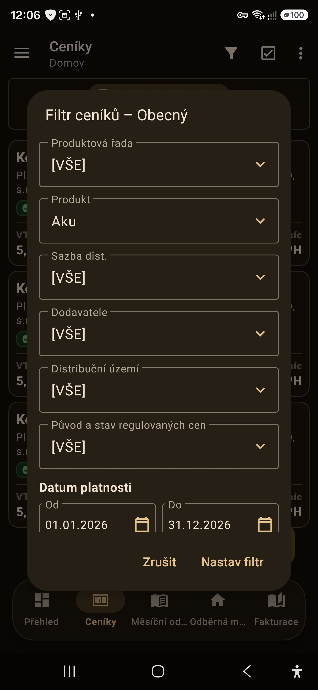
  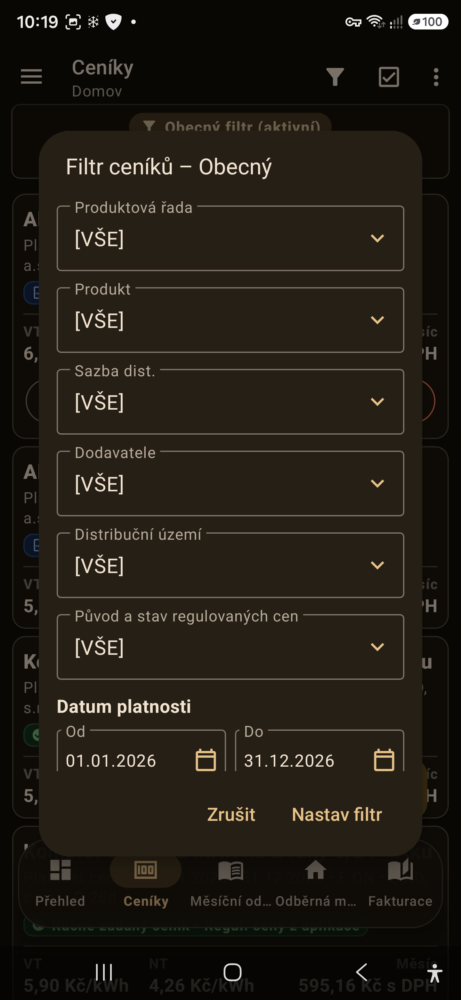
  

  
  

### Filtr ceníků pro měsíční odečty

1. Ve formuláři nového nebo upravovaného [měsíčního odečtu](#nav-vyber-ceniku-odecty) klepněte na
   **Vybrat ceník** nebo na tlačítko s názvem a platností již přiřazeného ceníku.
2. V seznamu klepněte na trychtýř nebo štítek **Filtr pro měsíční odečty**. Pro pravidelné odečty se
   hodí nastavit sazbu, dodavatele a distribuční území, které obvykle používáte. Při přechodu k
   jinému dodavateli nebo při doplňování staršího odečtu upravte podmínky. Pokud chcete vidět
   všechny ceníky, použijte reset přímo v tomto dialogu.
3. Po použití filtru označte jeden ceník a vraťte se šipkou zpět do formuláře. Vybraný ceník se
   použije při výpočtu ceny odečtu.

Při změně odběrného místa se použije jeho filtr pro měsíční odečty. U výběru pro jeden záznam může
seznam ponechat již přiřazený ceník mezi položkami, i když podmínkám filtru nevyhovuje. Stejně se
chová
výběr ve fakturaci.

  
  
  

### Filtr ceníků pro fakturaci

1. Ve [Fakturaci](#nav-fakturace) otevřete uloženou fakturu nebo **Období bez faktury**. V záložce
   **Faktura** otevřete formulář pro přidání záznamu, pokud je akce dostupná, nebo u stávající
   položky klepněte na **Uprav**.
2. Ve formuláři klepněte na **Vybrat ceník** nebo na název přiřazeného ceníku. V seznamu otevřete
   trychtýř nebo štítek **Filtr pro faktury**. Zde můžete podmínky uložit či resetovat stejným
   způsobem jako u ostatních filtrů.
3. Označte jeden ceník a vraťte se šipkou zpět do formuláře. U historické faktury zadejte do filtru
   období konkrétního záznamu, například leden až březen historického roku, a zkontrolujte také
   sazbu a distribuční území.

Platnost ceníku a období fakturačního záznamu zadáváte zvlášť. Filtr přebírá uložené podmínky
fakturace. Pokud se v seznamu objeví ceník platný jen po část zadaného rozsahu, zkontrolujte, zda
odpovídá právě upravované části faktury. Při změně ceny během vyúčtování vybírejte ceníky pro
jednotlivé části podle jejich platnosti.

V části **Období bez faktury** se filtr uplatní při ručním výběru ceníku v poloautomatickém režimu.
Při automatickém sestavení období se použijí ceníky z měsíčních odečtů. Nastavení filtru pro faktury
mění nabídku při ručním výběru, zatímco ceníky již uložené u jednotlivých záznamů zůstávají
přiřazené.

  

## Porovnání ceníků

Porovnání ukazuje, kolik by při stejné spotřebě, délce období a parametrech jističe stály různé
uložené ceníky. V žebříčku najdete nejlevnější nabídku pro zadané hodnoty. V grafech můžete zjistit,
která složka dělá největší rozdíl a při jaké spotřebě se může výhodnější nabídka změnit.

### Otevření porovnání a výběr ceníků

1. V hlavní nabídce klepněte na **Porovnání**. Na obrazovce jsou záložky **Přehled**, **Grafy**,
   **Výhodnost sazeb** a **Tabulka**. Můžete mezi nimi přepínat klepnutím na název nebo přejetím do
   strany.
2. V horní liště klepněte na ikonu seznamu **Ceníky (n)**. Číslo v závorce udává, kolik ceníků je
   právě vybráno.
3. V seznamu klepnutím na řádek ceník zaškrtnete nebo odeberete. Lze označit více ceníků současně. U
   každé položky zkontrolujte produkt, platnost, dodavatele, distribuční území a sazbu. Ve výběru
   otevřeném z porovnání lze kombinovat více jednotarifních ceníků nebo více dvoutarifních ceníků.
   Chcete-li přejít z jedné skupiny do druhé, nejprve původní výběr zrušte.
4. Tlačítko **Zobrazit vybrané** ukáže jen označené ceníky, včetně těch skrytých filtrem. **Zobrazit
   všechny** vrátí výpis podle aktuálního filtru a **Zrušit výběr** odebere všechna označení. Šipkou
   zpět v horní liště nebo tlačítkem **Zpět** potvrďte výběr a vraťte se k výsledkům.

Porovnání můžete otevřít také ze seznamu **Ceníky**. V horní liště zapněte **Režim výběru**, označte
položky a v nabídce se třemi tečkami zvolte **Porovnat vybrané ceníky**.

  
  

#### Použití filtrů při výběru

Klepnutím na ikonu trychtýře nebo na štítek nad seznamem
otevřete [obecný filtr ceníků](#filtrace-ceniku), který je společný se seznamem **Ceníky**. Dříve
zaškrtnuté ceníky zůstanou vybrané, i když je nový filtr skryje. Zkontrolujete je přes **Zobrazit
vybrané**.

  

### Vstupní hodnoty a přepočet

V horní liště otevřete **Vstupní hodnoty**. V dialogu **Nastavení parametrů pro porovnání** nastavte
následující údaje.

1. V části **Zdroj spotřeby** zvolte jeden ze tří způsobů zadání.
    - **Ruční zadání VT a NT** slouží k přímému zadání spotřeby za celé porovnávané období. Pole
      jsou v **MWh**. Například 1 500 kWh ve vysokém tarifu zadejte jako **1,5 MWh** do pole pro VT.
      Stejným způsobem zadejte NT.
    - **Načíst z odečtů za konkrétní rok** nabídne dostupné roky aktivního odběrného místa. Po
      výběru roku se doplní VT, NT a 12 měsíců. Pod výběrem roku uvidíte, zda spotřeba vychází z
      odečtů na hranicích roku nebo zda ji aplikace odhadla mezi odečty.
    - **Průměrná roční spotřeba z historie** dosadí průměr VT a NT a nastaví 12 měsíců. Aplikace
      využije dokončené roky se spotřebou. Pokud takové roky chybí, vychází z ostatních dostupných
      dat.
2. Zadejte **Počet měsíců**. Například pro půlroční porovnání použijte 6 měsíců a spotřebu za stejné
   půlroční období. Počet měsíců určuje, kolikrát se započítají měsíční platby. Zadaná spotřeba se
   použije v plné výši. Pro roční porovnání zadejte 12 měsíců.
3. V poli **Fáze x příkon** zadejte počet fází a hodnotu hlavního jističe v ampérech. Například pro
   jistič **3 × 25 A** zadejte vlevo 3 a vpravo 25. Údaje ovlivní platbu za jistič a v příslušných
   obdobích také poplatek POZE.
4. Posuňte obsah dialogu dolů. Pole **Další služby/slevy v ceníku neuvedené** odpovídají levému a
   pravému ceníku v záložce **Tabulka**. Zadejte celkovou částku za období v Kč bez DPH. Kladná
   částka přidá službu, záporná odečte slevu. Tyto částky se započítají v **Tabulce**. Žebříček a
   analýza výhodnosti vycházejí z cenových položek ceníků.

Tlačítko **OK** použije zadané hodnoty a přepočítá žebříček, grafy i **Tabulku**. Výsledky se
přepočítají také po návratu ze seznamu ceníků. **Vymaž všechna pole** vyčistí formulář a **Zrušit**
zavře dialog bez použití změn. Potvrzené číselné parametry si aplikace pamatuje pro aktivní odběrné
místo. Aktuální spotřebu, jistič a délku období můžete zkontrolovat na kartě **Vstupní parametry
porovnání** v záložce **Přehled**.

  

### Přehled výsledků a žebříček

Karty s jednotkovými cenami lze posouvat vodorovně. Každý sloupec odpovídá jednomu ceníku. Korunka
zvýrazňuje nejnižší kladnou hodnotu v řádku, pokud se hodnoty liší. Nejlevnější položka v jednom
řádku může patřit jinému ceníku než celkově nejlevnější varianta.

- **Neregulované ceny – Dodavatel (s DPH)** ukazují ceny za dodávku ve VT a NT v Kč/MWh a stálou
  měsíční platbu dodavateli.
- **Regulované ceny (s DPH)** se zobrazí, pokud se porovnávané regulované náklady liší. Karta
  ukazuje spotřební položky pro VT a NT, měsíční regulovanou platbu a sazby příspěvku na podporované
  zdroje energie (**POZE**) podle spotřeby a podle jističe. Spotřební a měsíční řádky zde zahrnují
  související položky, například systémové služby nebo činnost operátora trhu.
- **Celkové součtové ceny (s DPH)** spojují obchodní a další spotřební složky pro jednotlivé tarify
  a ukazují celkovou fixní platbu za měsíc. U výběru tvořeného jen jednotarifními ceníky se řádky NT
  skryjí.

Aplikace násobí jednotkové ceny spotřebou a stálé platby počtem měsíců. K dodávce přičte distribuci,
platbu za jistič, další regulované položky, daň z elektřiny a DPH. U jednotarifního ceníku ve
výpočtu žebříčku sečte VT a NT a celou spotřebu ocení ve VT. POZE a případné cenové úpravy vycházejí
z pravidel použitých pro rok ceníku. Pokud se u POZE počítají obě kladné varianty, podle spotřeby a
podle jističe, do výsledku vstupuje nižší částka. Vedle údajů o dodavateli, distribuci a platnosti
najdete také údaj o započteném POZE.

**Graf celkových ročních nákladů** porovnává délku vodorovných pruhů podle celkové ceny s DPH. Pod
ním **Žebříček vyhodnocených ceníků** řadí nabídky od nejlevnější. První položka má označení **★
NEJVÝHODNĚJŠÍ VARIANTA**. U dalších položek se zobrazuje, o kolik jsou dražší v Kč a v procentech z
ceny nejlevnějšího ceníku. Například **+702 Kč (+3,6 %)** znamená, že za stejné zadání zaplatíte
přibližně o 702 Kč více. Částky a procenta se zaokrouhlují samostatně.

Některé popisky uvádějí „roční“ nebo „Kč/rok“. Zobrazené součty odpovídají zadané spotřebě a počtu
měsíců. Při změně na šest měsíců proto součet představuje zadaný půlrok.

  
  
  

### Grafy

V záložce **Grafy** otevřete nabídku **Srovnávaná veličina**. Zvolený ukazatel se zobrazí pro
všechny vybrané ceníky.

- **Celkové roční náklady** ukazují cenu s DPH za zadané období. **Průměrné měsíční náklady** vydělí
  tuto cenu zadaným počtem měsíců.
- **Obchodní cena VT**, **Obchodní cena NT** a **Fixní měsíční platby** ukazují původní údaje z
  uloženého ceníku bez DPH. První dvě veličiny jsou v Kč/MWh. U fixních plateb zde jde o stálou
  měsíční platbu dodavatele v Kč za měsíc. Celkový součet fixních plateb včetně regulovaných položek
  najdete v **Přehledu**.
- **Regulovaná složka** a **Neregulovaná složka** ukazují samostatně vypočtené náklady za období
  před DPH. Regulovaná část zahrnuje například distribuci, jistič, systémové služby a příslušné
  POZE. Neregulovaná část obsahuje dodávku a stálé platby dodavateli.
- **Struktura ceny (Obchodní + Regulace + Daně)** rozdělí pruh na obchodní složku, regulovanou
  složku a daň z elektřiny. Úseky jsou bez DPH, částka vedle pruhu ukazuje celkovou cenu s DPH.
- **Rozdíl oproti nejlevnějšímu** ukazuje cenový rozdíl v Kč s DPH. Nejlevnější varianta má hodnotu
  **0 Kč**. Delší pruh znamená větší příplatek oproti ní.

Zvýraznění nejvýhodnějšího ceníku se řídí celkovými náklady v žebříčku. Při přepnutí na dílčí
veličinu proto porovnávejte i samotné částky a délky pruhů.

  
  
  

### Výhodnost sazeb

Pro srovnání výhodnosti vyberte alespoň dva ceníky. V části **Zdroj spotřeby pro analýzu** můžete
přepínat mezi dvěma způsoby zadání.

- **Modelová spotřeba** nabízí posuvník VT a u dvoutarifních sazeb také posuvník NT. Hodnoty se
  zobrazují v MWh i kWh. Posunutím můžete zkoušet, jak se výsledek mění s vyšší spotřebou nebo s
  jiným poměrem mezi tarify.
- **Historické odečty** načtou spotřebu aktivního odběrného místa. Posuvníkem zvolte, kolik
  posledních dostupných roků zahrnout do průměru. Pod posuvníkem se zobrazí použitý rozsah historie
  nebo informace o chybějících odečtech.

Výsledky se při změně zdroje nebo posuvníku přepočítávají průběžně. Nová spotřeba se promítne do
**Přehledu** a **Grafů**.

**Analýza bodu zvratu (Break-even point)** hledá hranici celkové spotřeby, při které se mění
nejlevnější varianta. Výpočet zachovává poměr VT a NT ze zvolené spotřeby a používá nastavený počet
měsíců a jistič. Text popisuje, která nabídka vychází nejlépe pod hranicí, nad ní nebo v
jednotlivých rozmezích. Může také uvést nejdražší nabídku. Pokud se vítěz v modelu nemění, text
označí nejvýhodnější variantu bez prahové hodnoty.

V grafu **Křivka celkových ročních nákladů** je vodorovně celková spotřeba v MWh a svisle cena v Kč.
Barevné čáry odpovídají nejvýše čtyřem vybraným ceníkům. Slovní analýza zohledňuje celý výběr.
Červená přerušovaná čára označuje aktuální spotřebu a zelený bod vyznačuje odhadnutou hranici, při
které se nejvýhodnější varianta mění. Výše fixních plateb určuje, kde čára začíná. Pokud při vyšší
spotřebě roste pomaleji, může se původně dražší nabídka vyplatit.

V části **Technické podmínky přiznání sazby** najdete karty distribučních sazeb z vybraných ceníků.
Karta ukazuje kód sazby, počet hodin NT, pokud je pro ni uveden, a stručné určení sazby. Klepnutím
kartu rozbalíte a zobrazíte podrobnosti, případné upozornění k historické sazbě a odkaz **Oficiální
podmínky distributora**. Před rozhodnutím podle ceny si v podmínkách ověřte, zda je daná sazba pro
vaše odběrné místo dostupná.

  
  

### Tabulka

V záložce **Tabulka** vyberte v levé a pravé rozbalovací nabídce dva ceníky z aktuálního výběru.
Tabulka se přepočítá po výběru jiného ceníku i po potvrzení **Vstupních hodnot** tlačítkem **OK**.
Při změně vstupů zůstanou oba ceníky a jejich přepínače zastropování nastavené tak, jak jste je
zvolili. Posuvníky v záložce **Výhodnost sazeb** mění spotřebu pro analýzu, žebříček a grafy. Pro
stejnou spotřebu v tabulce ji zadejte také do **Vstupních hodnot**.

Horní řádky uvádějí produkt, dodavatele, distribuci, sazbu a ceny jednotlivých položek. Najdete zde
obchodní a distribuční ceny VT a NT, měsíční plat dodavateli, sazby jističů, systémové služby,
činnost operátora trhu, daň z elektřiny a položky POZE. Jednotka vpravo říká, zda je cena uvedena za
MWh, měsíc, ampér nebo za celé období. Ve spodní části jsou vypočtené náklady za spotřebu VT a NT,
měsíční platby za zadané období, POZE, případné další služby či slevy a řádky **CELKEM (bez DPH)**,
**DPH** a **CELKEM (s DPH)**.

Sloupec **Rozdíl** odečítá částku pravého ceníku od levého. Kladná hodnota znamená, že položka vlevo
je dražší, záporná znamená, že je levnější. U celkové ceny tak přímo vidíte rozdíl zvolené dvojice
včetně služeb či slev.

Pokud je pro některý ceník dostupná historická úprava cen, zobrazí se přepínač pro příslušnou stranu
u popisku **Zastropované ceny**. Přepínačem použijete upravené hodnoty v tabulce. Po změně vybrané
dvojice se přepínače vrátí na původní ceníkové hodnoty. Pro celkové pořadí všech vybraných ceníků
použijte žebříček na záložce **Přehled**. Výsledné částky mohou být odlišné zejména u jednotarifního
ceníku se zadaným NT nebo při odlišném výpočtu POZE. Při porovnání jednotarifních nabídek zadejte
celou spotřebu jako VT a NT ponechte na nule.

  

## Čas HDO

V hlavní nabídce otevřete **Časy HDO**. Rozvrh spínání je uložený pro aktivní odběrné místo. V horní
kartě uvidíte čas elektroměru a u dostupných relé také stav a zbývající čas do sepnutí nebo vypnutí.
Pokud hodiny elektroměru ukazují jiný čas, nastavte **Rozdíl hodin**. Aplikace posun použije při
určování aktuálního tarifu a dalších přepnutí.

### Zobrazení a upozornění

- **Seznamové zobrazení** ukazuje období platnosti, dny v týdnu a časové intervaly. U jednotlivých
  intervalů můžete zapnout upozornění **Začátek** a **Konec**. Pokud oznámení nepřicházejí,
  zkontrolujte [nastavení upozornění](#nav-nastaveni).
- **Grafické zobrazení** ukazuje intervaly sepnutí na 24hodinovém ciferníku. Pokud se rozvrh liší
  podle dnů, graf zobrazí příslušné skupiny zvlášť. Více druhů relé může být zakresleno v
  soustředných úrovních s barevnou legendou. Pokud je k dispozici více rozvrhů pro jediné relé,
  mohou se dva ciferníky zobrazit vedle sebe. Při více relé má každý ciferník vlastní řádek s místem
  pro legendu.
- Je-li k dispozici více relé, v horní kartě vyberte hlavní relé, podle kterého aplikace určuje
  tarif pro cenovou kartu v [Přehledu](#nav-prehled). V seznamu můžete přepnout zobrazení mezi
  uloženými relé.

  
  
  

### Přidání a načtení časů

1. Pokud časy znáte, otevřete tlačítko **+** (**Přidat čas HDO**) a zadejte interval a dny
   platnosti. Uloženou položku můžete v seznamu upravit nebo odstranit.
2. Pro načtení rozvrhu od distributora zvolte **Načti HDO z internetu**, vyberte distribuční území a
   podle distributora doplňte další údaje, například oblast, okres a kód HDO. Tlačítko **Zobraz
   www** otevře stránku distributora v prohlížeči.
3. Klepněte na **Načti HDO** a zkontrolujte načtené intervaly a jejich platnost. Pokud se rozvrh
   nepodaří načíst, ověřte údaje a připojení. Volba **Ulož do schránky** zkopíruje načtený rozvrh ve
   formě textu. Tlačítkem **Ulož HDO** a potvrzením dialogu nahradíte dříve uložené časy pro odběrné
   místo.

  
  
  

## Statistika spotřeby

V hlavní nabídce otevřete **Graf spotřeby**. Historii z uložených odečtů lze zobrazit jako čáru nebo
sloupce. Barvy tarifů vycházejí z [nastavení barev grafů](#nav-barvy-grafu).

- Tlačítko s ikonou grafu přepíná mezi čárovým a sloupcovým zobrazením. Tlačítko období postupně
  nabízí měsíční spotřebu, roční spotřebu a srovnání jednoho kalendářního měsíce mezi různými roky.
- Tlačítky **VT** a **NT** skryjete nebo znovu zobrazíte příslušný tarif. Nejméně jeden tarif
  zůstává zobrazený.
- V měsíčním a ročním zobrazení upravíte tlačítky **+** a **−** hustotu vodorovné mřížky. Při
  srovnání jednoho měsíce se na jejich místě zobrazí šipky pro výběr měsíce. Aplikace při přepínání
  přeskočí měsíce bez dat. Podržením tlačítka zobrazíte nápovědu k jeho funkci.

  
  

  
  

## Záloha lokální

V hlavní nabídce otevřete **Záloha místní**. Záloha v souboru ZIP zahrnuje obě databáze aplikace.
Obsahuje například odběrná místa, měsíční odečty, faktury, platby, časy HDO, ceníky
a [uložené filtry ceníků](#filtrace-ceniku) jednotlivých odběrných míst.

### Vytvoření zálohy

1. Ikonou složky v horní liště otevřete systémový výběr složky a udělte aplikaci přístup. Stejnou
   složku aplikace používá pro [export ceníků](#nav-export-ceniku).
2. Ikonou zálohy v horní liště vytvořte záložní soubor. Zálohu můžete vytvářet také při ukládání
   nových [měsíčních odečtů](#nav-mesicni-odecty).
3. Soubor ZIP lze z vybrané složky zkopírovat do počítače nebo jiného úložiště.

  

### Obnova, odeslání a odstranění záloh

Klepnutím na zálohu zobrazíte **Obnov data**, **Záloha Google** a **Smaž**. Obnovením se načtou data
ze zvolené zálohy. Novější záznamy v databázích se tím mohou ztratit. Filtry se vrátí do stavu při
vytvoření vybrané zálohy. Po obnově zálohy z verze před zavedením filtrů podle odběrných míst se
seznamy ceníků zobrazí bez omezení, dokud filtry znovu nenastavíte.

Podržením položky zapnete
režim výběru a můžete pracovat s více soubory, například je odstranit nebo odeslat na Google Drive.

Odeslání na Google Drive vyžaduje přihlášení a udělení přístupu k aplikačnímu prostoru. Odeslané
zálohy uvidíte v části [Záloha Google](#nav-zaloha-google). Aplikace může odeslat soubory ihned
podle [nastavení připojení](#nav-nastaveni). Pokud odeslání zařadíte do fronty, počká na Wi‑Fi.

  
  

## Záloha Google

V hlavní nabídce otevřete **Záloha Google**. Ikonou v horní liště se přihlaste Google účtem a
potvrďte přístup. Aplikace pracuje se záložními soubory ve vlastním aplikačním prostoru Google
Drive. Běžné soubory z Disku se v seznamu nezobrazují.

- Klepnutím na zálohu zobrazíte **Obnov data**, **Uložit do zařízení** a **Smaž**. Při obnovení se
  načtou data z vybrané zálohy. **Uložit do zařízení** stáhne kopii záložního souboru do místního
  úložiště.
- Podržením položky zapnete vícenásobný výběr. Označené soubory lze odstranit nebo uložit společně
  přes **Uložit vybrané (n)** v nabídce se třemi tečkami. Číslo udává počet vybraných souborů.
- Ikonou účtu v horní liště se můžete také odhlásit.

  
  
  

## Export ceníků

V hlavní nabídce otevřete **Export ceníků**. Export uloží vybranou sadu ceníků do souboru JSON. Tato
část vyžaduje přístup do lokální složky, která je společná se složkou pro ukládání záloh.

Ceníky se ukládají ve formátu JSON. Seznam obsahuje ceníky uložené v aplikaci a seskupené podle názvu. Jeden ceník může obsahovat více distribučních sazeb, například D01d, D02d nebo D25d.

Kliknutím na položku ceníku a potvrzením dialogu se ceník uloží do vybrané složky. Takto uložený soubor lze přenést do jiné instalace aplikace na jiném zařízení.

  

## Import ceníků

V hlavní nabídce otevřete **Import ceníků** a klepněte na **Vyber složku**. Vyberte složku se
soubory JSON, které vznikly při [exportu ceníků](#nav-export-ceniku). Soubor může obsahovat více
distribučních sazeb. Dokument PDF od dodavatele načtete [přes obrazovku Ceníky](#nav-import-pdf).

Klepněte na soubor a zvolte **Přidat do aplikace**. V dialogu vyberte distribuční sazby a potvrďte
**OK**. Pokud aplikace najde odpovídající uložený ceník, nabídne volbu, zda jej přepsat. Akce
**Smazat** u souboru slouží k odstranění souboru z vybrané složky.

  

## Nastavení aplikace

V horní liště klepněte na nabídku se třemi tečkami a zvolte **Nastavení aplikace**. Volby v této
části se ukládají při změně. U prvních dvou položek v části **Upozornění** se oprávnění mění v
nastavení Androidu.

### Upozornění

- **Povolené notifikace** ukazují stav oprávnění k zobrazování oznámení na Androidu 13 a novějším.
  Klepnutím otevřete systémové nastavení oznámení pro aplikaci. Po návratu zaškrtávací políčko
  zobrazí aktuální stav.
- **Povolené přesné alarmy** ukazují, zda Android dovoluje aplikaci plánovat alarmy na přesný čas.
  Položka je dostupná od Androidu 12 a klepnutím otevře správu tohoto oprávnění. Po povolení
  aplikace přeplánuje alarmy HDO. Pokud systém přesný alarm nepovolí, aplikace ho naplánuje
  přibližně a upozornění může přijít později.
- **Vynutit přesné notifikace HDO** zapněte, pokud oznámení o začátku nebo konci nízkého tarifu
  přicházejí se zpožděním nebo vůbec. Aplikace se pak pokusí naplánovat upozornění jako systémové
  budíky. Při každé změně volby přeplánuje uložené alarmy HDO. Zobrazení oznámení se nadále řídí
  oprávněním Androidu.
- **Upozornění na staré časy HDO** zapíná dialog při spuštění aplikace, pokud vypršela platnost
  uloženého rozvrhu některého odběrného místa. Dialog nabídne stažení aktuálních časů. Vypnutím
  volby skryjete tento dialog. Kontrola platnosti a případná systémová oznámení o konci platnosti
  fungují i při vypnuté volbě.

### Přidávání záznamů

- V rozbalovacím seznamu **Tlačítko pro přidání záznamu** zvolte **Floating Action Button (FAB)**
  pro plovoucí tlačítko ve spodní části obrazovky nebo **Tlačítko v záhlaví (AppBar)** pro akci v
  horní liště. Volba se projeví například v měsíčních odečtech, cenících, fakturaci, platbách,
  správě odběrných míst a na obrazovce HDO.
- **Předvyplnit aktuální datum odečtu** vloží dnešní datum do formuláře nového měsíčního odečtu.
  Před uložením můžete datum upravit. Při vypnuté volbě klepněte ve formuláři na **Datum** a zvolte
  datum ručně.

### Zobrazení navigace

- **Zobrazit dolní panel rychlé navigace** zapíná plovoucí panel se zkratkami při použití zařízení
  na výšku.
- **Zobrazit levý panel rychlé navigace** ovládá levý panel při použití zařízení na šířku. Na šířku
  se levý panel zobrazí, pokud je zapnutá alespoň jedna z obou voleb rychlé navigace. Chcete-li jej
  skrýt, vypněte obě volby.

Hlavní nabídku lze dál otevřít ikonou tří vodorovných čar.

### Připojení

Volba **Povolit použití mobilních dat pro online funkce** se uplatní například při načítání časů HDO
a práci se zálohami na Google Drive. Po vypnutí se tyto funkce používají přes Wi‑Fi. Samostatné
odesílání záloh zařazených do fronty pro Wi‑Fi čeká na Wi‑Fi připojení.

### Vzhled

**Dynamické barvy (Material You)** přizpůsobí paletu rozhraní barvám systémové tapety. Přepínač se
zobrazí na podporovaných zařízeních s Androidem 12 nebo novějším. Po změně se rozhraní znovu načte a
aplikace obnoví také umístěné widgety. Vypnutím se vrátíte k výchozí paletě aplikace. Barvy vysokého
a nízkého tarifu se vybírají samostatně.

  
  

### Nastavení barev grafů

V hlavní nabídce otevřete **Barva tarifu**. Na této obrazovce lze samostatně nastavit barvu vysokého
tarifu (**VT**) a nízkého tarifu (**NT**). Zvolená dvojice barev platí pro všechna odběrná místa.

1. V kartě **Barva VT** nebo **Barva NT** klepněte na barevné kolečko. Každá karta mění barvu svého
   tarifu a vedle názvu ukazuje její hexadecimální kód.
2. V části **Jemné doladění barev** použijte horní dvojici ovládacích ploch pro VT a dolní pro NT.
   Prstem po velké ploše měníte vodorovně odstín a svisle sytost. Na úzkém pruhu pod ní upravíte
   jas.
3. Pro přesné zadání klepněte na zobrazený kód barvy nebo na **Nastavení barvy** v horní liště. V
   dialogu zadejte kódy ve formátu `#RRGGBB`, například `#FF1744`, nebo vyberte dvojici z **Historie
   použitých barev**. Tlačítko **Nastavit** přenese dvojici do náhledu.
4. Pokud chcete zvolit obě barvy najednou, v části **Doporučená témata** klepněte na dvojici v
   nabídce pro světlý nebo tmavý režim. Levé kolečko označuje VT, pravé NT. Názvy skupin označují
   pozadí, pro které jsou barvy doporučené.
5. V části **Náhled v grafu** zkontrolujte obě barvy na ukázkových sloupcích a v legendě. Dole
   klepněte na **Uložit**. Aplikace potvrdí uložení a přidá dvojici do historie, která uchovává až
   pět položek.

Uložené barvy rozlišují tarify ve sloupcových i čárových grafech na obrazovce **Graf spotřeby** a ve
sloupcích ročního grafu ve správě odběrného místa. Roční graf je používá také při výběru barev
cenových čar s ohledem na jejich čitelnost. V novém [**Přehledu**](#nav-prehled) se změna projeví v
pruhu, prstencovém grafu a označení tarifů na kartě **Spotřeba období** a ve sloupcích a legendě na
kartě **Přehled spotřeby**. V původním přehledu se použije v grafech spotřeby u uložených faktur.
Barvy tarifů přebírají i widgety aktuální ceny a spotřeby na ploše Androidu.

  
  

## Widgety na ploše Androidu

Na ploše Androidu otevřete systémovou nabídku **Widgety** a vyberte jeden z widgetů aplikace. Při
přidání zvolte v **Nastavení widgetu** odběrné místo a klepněte na **Uložit**. Každý widget může
zobrazovat jiné místo. Po klepnutí na widget aplikace otevře související obrazovku pro nastavené
odběrné místo.

- **Aktuální cena elektřiny** ukazuje jednotkové ceny a informaci o HDO. V části **Zobrazení ceny**
  zvolte **Celková cena** nebo **Obchodní cena**. V části **DPH** vyberte **Zahrnout** nebo
  **Nezahrnout**. Klepnutím na kartu otevřete **Přehled**.
- **Analogové hodiny HDO** znázorňují uložené intervaly na 24hodinovém ciferníku. Klepnutím otevřete
  **Časy HDO**.
- **Spotřeba elektřiny** ukazuje spotřebu období a rozdělení mezi VT a NT. Klepnutím otevřete
  **Měsíční odečty**.
- **Finanční bilance** porovnává evidované zálohy a vypočtené náklady. Klepnutím otevřete
  **Fakturaci**.
- **Nový odečet** otevře formulář pro zapsání stavu elektroměru.

Na prvním snímku je nastavení widgetu **Aktuální cena elektřiny** pro odběrné místo **Domov**. Druhý
snímek ukazuje všech pět widgetů na ploše pro stejné místo.

  
  

## Přehled

V hlavní nabídce otevřete **Přehled**. Na jednom místě uvidíte ceny elektřiny, časy spínání HDO,
poslední stav elektroměru, spotřebu a vyúčtování. Posunutím obrazovky dolů se dostanete k historii
spotřeby a fakturám. Pokud máte zobrazenou původní podobu obrazovky, v nabídce se třemi tečkami
zvolte **Přepnout na nový přehled**. Položkou **Přepnout na původní přehled** se můžete vrátit.

  

### Výběr odběrného místa

Název mezi šipkami označuje odběrné místo, jehož údaje vidíte na kartách. Levá šipka zobrazí
předchozí místo, pravá následující. Na konci seznamu je příslušná šipka neaktivní. Pokud máte jen
jedno odběrné místo, šipky se skryjí. Bez vybraného odběrného místa se místo karet zobrazí
upozornění.

Šipky mění zobrazení na Přehledu. Jakmile z některé karty nebo řádku faktury otevřete další
obrazovku, aplikace podle potřeby nastaví zobrazené místo jako aktivní pro celou aplikaci a oznámí
změnu. Aktivní místo můžete vybrat také položkou **Odběrné místo** v nabídce se třemi tečkami, pokud
máte uloženo více míst. Ve stejné nabídce je **Nastavení aplikace**.

### Aktuální cena elektřiny a HDO

Karta ukazuje cenu za jednu kilowatthodinu ve vysokém tarifu (**VT**) a nízkém tarifu (**NT**) v
Kč/kWh. Aplikace použije ceník přiřazený k poslednímu odečtu. Pokud u něj ceník není přiřazený,
hledá ho u posledního záznamu nevyfakturovaného období a potom u posledního záznamu fakturace. Bez
dostupného ceníku se zobrazí nulové ceny.

- **Celková cena** zahrnuje obchodní cenu, distribuci za odebranou energii a další položky účtované
  za spotřebu, například systémové služby a daň z elektřiny. Stálé měsíční platby, například platba
  za jistič, se započítávají do nákladů ve vyúčtování.
- **Obchodní cena** ukazuje cenu samotné dodávky elektřiny podle ceníku dodavatele.
- Zapnutý přepínač **DPH** zobrazí jednotkové ceny s DPH, vypnutý bez DPH. Tato volba se týká cenové
  karty. Částky ve vyúčtování se zobrazují s DPH. Aplikace si pamatuje režim ceny i stav DPH.

Zvýraznění a fajfka označují tarif, který právě platí podle uloženého rozvrhu HDO (hromadného
dálkového ovládání). Pod cenami najdete čas dalšího přepnutí, označení dne a zbývající dobu do
přepnutí. Aplikace používá rozvrh hlavního relé HDO a zohledňuje nastavený posun času elektroměru.
Bez uloženého rozvrhu zůstane zvýrazněný VT a zobrazí se **HDO není nastaveno**. Pokud z uložených
časů nelze určit další přepnutí, karta oznámí, že nejsou k dispozici platná data.

### Odečty a hodiny HDO

- **Měsíční odečty** ukazují poslední uložený stav počítadel VT a NT a datum odečtu. Poslední
  zvýrazněná číslice počítadla představuje desetiny kWh. Pokud žádný odečet nemáte, karta zobrazí
  **Zatím žádný odečet**. Klepnutím otevřete seznam měsíčních odečtů.
- **Hodiny HDO** mají 24hodinový ciferník. Ručička ukazuje aktuální čas se započteným posunem
  elektroměru. Barevné výseče znázorňují dnešní intervaly sepnutí uložených relé HDO. Pokud máte
  více druhů relé, mohou se výseče zobrazit v několika soustředných úrovních. Klepnutím otevřete
  obrazovku **Časy HDO** s podrobným rozvrhem spínání.
- **Nový odečet** s ikonou plus otevře formulář pro zadání odečtu zobrazeného odběrného místa.

### Spotřeba období

Karta uvádí začátek a konec fakturačního období a spotřebu v kWh podle tarifů. Přednost má aktuální
**Období bez faktury** s dostupným rozsahem dat. Pokud takové období chybí, zobrazí se nejnovější
uložené období s dostupným rozsahem dat. Spotřeba vychází z rozdílů počátečních a konečných stavů
elektroměru zadaných pro dané období.

Procento u VT a NT vyjadřuje podíl příslušného tarifu na celkové spotřebě. Stejný poměr znázorňuje
vodorovný pruh i prstencový graf, uprostřed kterého je součet v kWh. Například **1 040 kWh ve VT (
48 %)** a **1 133 kWh v NT (52 %)** dávají dohromady **2 173 kWh**. Při nulové spotřebě jsou oba
podíly nulové. U jednotarifního období se řádek NT skryje.

Klepnutím na kartu otevřete **Období bez faktury**, i když karta zobrazuje údaje z poslední uložené
faktury.

### Přehled spotřeby

Přepínač **Měsíční / Roční** mění zobrazení mezi nejvýše pěti posledními dostupnými měsíci a pěti
posledními dostupnými kalendářními roky. Aplikace si volbu pamatuje. Na vodorovné ose jsou měsíce
nebo roky, na svislé spotřeba v kWh. Barevné části každého sloupce ukazují skutečnou spotřebu ve VT
a NT vypočtenou z uložených měsíčních odečtů. Přerušovaná část **Odhad** přidává očekávanou spotřebu
za zbývající část období. Horní okraj sloupce tak ukazuje odhad celkové spotřeby za období. Odhad je
společný pro oba tarify.

Klepnutím na kartu mimo přepínač otevřete podrobný [**Graf spotřeby**](#nav-graf-spotreby) v právě
zvoleném měsíčním nebo ročním režimu.

#### Jak se odhaduje měsíční spotřeba

1. Odhad se počítá pro aktuální kalendářní měsíc, pokud pro něj už je záznam spotřeby a odečty zatím
   nepokrývají jeho poslední den. Aplikace sečte dosavadní spotřebu ve VT a NT, vydělí ji počtem dní
   pokrytých odečty a zjistí, kolik dní zbývá do konce měsíce.
2. Pro zbývající dny hledá obvyklou spotřebu stejného měsíce v předchozích letech. Použije až čtyři
   nejnovější dostupné záznamy a novějším dá větší váhu. Tento průměr upraví podle toho, jak se
   poslední až tři dostupné srovnatelné měsíce lišily od svých historických průměrů.
3. Pokud historie stejného měsíce chybí, použije až tři poslední dostupné ukončené měsíce a zohlední
   sezónní rozdíly mezi nimi a odhadovaným měsícem. Když chybí i tyto podklady, vychází z dosavadní
   denní spotřeby aktuálního měsíce.
4. Denní odhad pro zbývající dny je kombinací dosavadního tempa a očekávané spotřeby podle historie
   nebo sezóny. Čím větší část měsíce odečty pokrývají, tím větší váhu má dosavadní tempo. Aplikace
   tímto denním odhadem vynásobí zbývající dny a výsledek přičte ke skutečné spotřebě.

#### Jak se odhaduje roční spotřeba

Základem je součet spotřeby zaznamenané od začátku aktuálního kalendářního roku. Pokud poslední
záznam patří do právě probíhajícího neúplného měsíce, aplikace přičte odhad za jeho zbývající dny.
Potom dopočítá celé měsíce po posledním zaznamenaném měsíci až do prosince.

Pro každý z těchto měsíců použije historický průměr téhož kalendářního měsíce a upraví ho podle
toho, jak se dokončené měsíce letošního roku zatím liší od stejných měsíců v minulosti. Pokud pro
daný měsíc historie chybí, odvodí obvyklou spotřebu z dokončených měsíců letošního roku a zohlední
sezónu. Když letošní dokončené měsíce chybí, využije ostatní dokončené měsíce, případně dosavadní
tempo aktuálního měsíce. Roční odhad potřebuje alespoň jeden měsíční záznam spotřeby z aktuálního
roku.

U měsíčního i ročního odhadu aplikace při sezónním přepočtu porovnává spotřebu v zimních měsících
(listopad až březen) a v letních měsících (květen až září). Čím vyšší je zimní spotřeba oproti
letní, tím víc odhad odpovídá průběhu typickému pro elektrické vytápění. Pokud údaje pro porovnání
chybí, aplikace se řídí distribuční sazbou z dostupného ceníku. Při úpravě historického průměru
podle trendu aplikace omezuje výsledek na 65 až 150 % původního průměru. Pokud trend nelze
vypočítat, použije historický průměr beze změny. Odhad se po přidání odečtů může změnit.

#### Co znamenají procenta nad sloupci

Procento říká, o kolik se změnila **průměrná denní spotřeba ve VT a NT dohromady** oproti
předchozímu zobrazenému období. Aplikace nejdřív vydělí spotřebu každého období počtem dní, které
pokrývá. Díky tomu lze porovnat například únor s březnem i při různé délce odečtových intervalů. U
sloupce s odhadem vstupuje do denního průměru také odhadnutá spotřeba a dny, za které se přičítá.

Kladné procento označuje nárůst denního průměru, záporné pokles. Například **+18 %** nad rokem 2026
na snímku znamená, že podle odhadu je průměrná denní spotřeba za rok 2026 o 18 % vyšší než za
předchozí zobrazený rok. Nad prvním sloupcem a tam, kde je předchozí průměr nulový, procento chybí.

### Vyúčtování a poslední faktury

Karta **Vyúčtování** zobrazuje stejný rozsah dat jako karta **Spotřeba období**. Pod ním najdete tři
částky v Kč.

- **Zálohy** jsou součtem evidovaných zálohových plateb přiřazených k období. Pokud součet samotných
  záloh není kladný, aplikace použije součet evidovaných plateb za období.
- **Náklady** jsou vypočtené z odebrané energie, přiřazených ceníků, stálých plateb a dalších
  evidovaných služeb, se započtením DPH a uložených slev.
- Rozdíl **zálohy minus náklady** určuje výsledek. Vyšší zálohy znamenají **Přeplatek**, vyšší
  náklady **Nedoplatek** a shodné částky **Vyrovnáno**. U nevyfakturovaného období jde o průběžný
  výsledek podle uložených údajů.

Střed vodorovného ukazatele odpovídá vyrovnané bilanci. Přeplatek směřuje doprava, nedoplatek
doleva. Délka barevné části odpovídá poměru rozdílu k vyšší z obou částek. Pokud jsou evidované
zálohy kladné, text uprostřed ukazuje poměr **náklady ÷ zálohy × 100**. Procento přeplatku nebo
nedoplatku vyjadřuje rozdíl vůči 100 %. Například náklady ve výši 120 % záloh znamenají **Nedoplatek
−20 %**. Při nulových zálohách a kladných nákladech se uprostřed zobrazí **Bez záloh**, ukazatel se
vyplní doleva a nedoplatek v Kč odpovídá celé výši nákladů. Když jsou obě částky nulové, prostřední
popisek ukáže **0 %**.

Na snímku jsou zálohy **27 000 Kč** a náklady **12 668 Kč**. Náklady tvoří po zaokrouhlení **47 %**
záloh. Zbývajících **53 %** představuje přeplatek **14 332 Kč**. Klepnutím na souhrn vyúčtování nad
seznamem faktur otevřete **Období bez faktury**.

Pod souhrnem jsou až tři **Poslední faktury**. Každý řádek ukazuje číslo faktury, fakturační období,
celkovou spotřebu v kWh a vypočtenou celkovou cenu s DPH. Záznam bez vyplněného čísla se zobrazí pod
označením **Období bez faktury**. Klepnutím na řádek nebo jeho šipku otevřete detail dané faktury.
Tlačítko **Zobrazit všechny faktury** otevře seznam **Fakturace** pro zobrazené odběrné místo. Pokud
ještě nemáte žádnou vyúčtovanou fakturu, karta zobrazí **Zatím žádné vyúčtované faktury**.

  

### Původní přehled

Po přepnutí na původní přehled uvidíte poslední stavy počítadel, graf spínání HDO, souhrn plateb a
nákladů a seznam fakturačních období se spotřebou. Šipkami u názvu odběrného místa procházíte údaje
jednotlivých míst. Přepínač **Celková spotřeba** zobrazí u fakturačních období součet VT a NT. Po
vypnutí uvidíte oba tarify zvlášť. Rozbalovací nabídka vedle přepínače umožňuje řadit záznamy podle
data, čísla faktury nebo spotřeby ve VT, NT či celkem.
